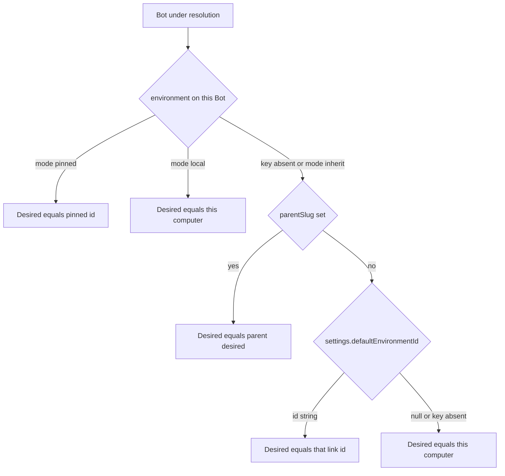

# Bot execution environment

| Field | Value |
| Author | hbots design |
| Date | 2026-11-10, revised 2026-11-11 |
| Status | Draft |
| Scope | Where a Bot's T3 project and main thread are created, and which models that computer offers |

## Overview

hbots talks to one local T3 Code and creates each Bot's project and main thread with no environment id. The person cannot say "run this Bot on that linked computer." This design adds that choice at three layers (app default, Bot, durable child Bot), records the environment of a turn-scoped T3 child when T3 reports one, and adds an optional fallback that stays off unless the person turns it on. Settings is where the default computer is set. A Bot's details page, and a durable child's edit sheet, show the computer the conversation is on and the computer it is set to, and can change the setting. The model picker lists the providers of the computer that Bot is set to, not the providers of whatever machine hbots itself is talking to.

The local T3 remains the only broker. hbots keeps one session token and selects among links T3 already has. A remote placement does not copy the Bot folder. On this computer the workspace stays the Bot folder, as it is today. On a linked computer, T3 creates its own project repository, or uses a folder path the person typed for that machine. Remote execution is blocked until T3 accepts the existing hbots token for an environment-scoped create and launch. That gap was observed, and it is requirement R1 below, not a method this document invents.

## Background & Motivation

### Current state

`T3_URL` defaults to `http://127.0.0.1:3773` in `gateway/src/config.rs`. `hbots up` probes `GET {T3_URL}/.well-known/t3/environment` from `gateway/src/cli.rs`. The RPC client is `T3Client` in `gateway/src/t3.rs`: a WebSocket at `{ws_base}/ws?orchestrationProtocol=2&clientSurface=web&clientAppVersion=bots-rs-...`. `T3Client::call` times out at 30 seconds. `dispatch` wraps `orchestration.dispatchCommand`. Nothing on that client sends an `environmentId`. `hbots up` writes `T3_TOKEN_FILE` as `~/.hbots/t3-token` (`gateway/src/cli.rs`). `Config::from_env` reads `T3_TOKEN`, then `T3_TOKEN_FILE`, and if that variable is unset it reads `~/.hbots/.t3-token` (`gateway/src/config.rs`). A normal `hbots up` points the variable at `t3-token`. The dotted name is still the fallback when the variable is absent.

Settings live under the hbots home (`~/.hbots` unless `HBOTS_HOME` is set), in the document `AppState::settings` builds from `settings_defaults` in `gateway/src/main.rs` (relative path `bots/.botapp/settings.json`). Defaults include `defaultModel: null`, `autoReview: true`, and `beta.projects: false`. After `store::merge`, `settings()` replaces `beta` with `{ "projects": saved["beta"]["projects"] == true }`, so every other beta key is dropped on read. `put_settings` then writes that merged document, so a later `userName` save would persist the stripped object. `PUT /api/settings` checks a model object and the `defaultRuntimeMode` enum. The beta allow-list in `put_settings` is the single key `projects`. The settings screen is the Exact contract in `app/app.contract`. Domains are `user`, `models`, `access`, and `updates`. On the models domain, default approval is the radio group and default model is `ModelPicker`, not a second radio group. `app/app.ts` `loadPrefs` maps `defaultRuntimeMode`. The new environment controls sit on that same domain, next to the approval radios and the model picker.

`provisioner::launch_runtime_mode` in `gateway/src/provisioner.rs` resolves Bot `runtimeMode`, then settings `defaultRuntimeMode`, then `autoReview == false` to `full-access`, otherwise `auto`. Model resolution inside `tick` is `bot.model`, else `settings.defaultModel`, else `default_model()`: Claude Haiku, `{ instanceId: claudeAgent, model: claude-haiku-5-5, options effort medium }`. This design does not change that function or that default.

`provisioner::tick` lists projects with `GET /api/projects`. If `projectId` is absent from that local list, it does not keep the stored id. It matches `workspaceRoot`, and if that misses it calls `projects.mutate` `project.create`, then `Bots::save`s the new local `projectId`. The create payload sends `title` (`bot["name"]`), `workspaceRoot`, `createWorkspaceRootIfMissing: true`, and `defaultModelSelection`. It then syncs the face through `project_face_update` and calls `orchestration.launchThread` with `projectId`, `modelSelection`, `runtimeMode`, `interactionMode: default`, and `workspaceStrategy: { type: root }`. No environment is passed. The Bot folder is on this host, so the `workspaceRoot` match hits for a remote id that the local list does not contain. The next pass would replace that id and then face-update, and it can `message.dispatch` using the still-remote `mainThreadId`. Errors use `?`, so one Bot aborts the pass. `provisioner::start` logs a warning and retries every 5 seconds, or sooner on `provision_now`.

`workspaceRoot` is computed, not stored. `Bots::load` in `gateway/src/bots.rs` sets it to `<bots root>/<slug>`. `persist` removes `slug` and `workspaceRoot` and keeps every other key. The folder (memory, skills, `AGENTS.md`, `.bot/bot.json`, `.mcp.json`) is on the machine that runs hbots. `.mcp.json` points the agent at loopback `POST /mcp/bot`. The refusal of non-local callers is `mcp_route` in `gateway/src/main.rs`. `gateway/src/mcp.rs` only points at that route. `docs/backends.md` already records the local-folder assumption.

A durable subagent is a child Bot: `role: subagent`, `parentSlug`, `hideFromSidebar`, and `subagent: { prompt, inheritParentPrompt, toolAllow }`. Nesting is refused. `Bots::create` builds the child. `Bots::save` replaces the whole `subagent` object. MCP `subagent_create` and `subagent_list` in `gateway/src/subagent_tools.rs` call that path. Arguments today are `threadId`, `prompt` (required, max 2000), `name`, `inheritParentPrompt` (default false), and `task`. A `parentSlug` argument is ignored. Each child gets its own project and main thread from the same provisioner. `provision_now.notify_one()` runs after create.

Turn-scoped help is different. It is a T3 child thread (`relationshipToParent=subagent`, including `delegate_task`). The Subagents list does not show it. Lineage and Working on do. `gateway/src/lineage.rs` stores a remote child as `{ threadId, environmentId }`. `open_child` returns nothing when the child is remote. `thread_for` refuses it with the existing gateway sentence "That thread stays on the other machine." `docs/PLAN.md` records the same rule. hbots must not collapse these two mechanisms.

`environmentId` already means "another T3 machine" in two places that this design must not overload:

- Project-board links. `gateway/src/projects.rs` `clean_link` / `env_id` accepts `environmentId` on thread and t3project links: one line, max 128, ASCII letters, digits, `_`, and `-`. Link identity includes that id.
- Lineage remote children, as above.

`roster::list` calls local `orchestration.getThreadProjection` for every `mainThreadId`. `roster::enrich` joins that result. It does not issue the RPC. `working` is true when `release::thread_is_busy` is true or `activeRunId` is a string (`gateway/src/roster.rs`). Chat read and send, voice, stop, computer open/close/steer/control/input, lineage, library, usage, thread previews, model push, routine writes, and `room_snapshot` also pass `mainThreadId` or `projectId` to the local broker. A thread id from another machine must not be sent there. `app.ts` `loadBots` sets `ready` from `typeof mainThreadId === 'string'`. `lineOf` then turns a string id plus an empty preview into the hardcoded English `Ready to chat`, and a missing id into `Getting set up…`. Those two sentences are not string keys. A null preview is not a blank inbox row. Skipping the projection, and leaving the shape unchanged, would still show a remote Bot as ready to chat.

### What was verified on the running T3

Read-only, against T3 Code Nightly `0.1.9-nightly.20261110.4452` on this machine. The app bundle is `/Applications/T3 Code (Nightly).app`. Schema text below is from that build's asar, not from an hbots type.

`GET http://127.0.0.1:3773/.well-known/t3/environment`, re-read on 2026-11-11, is not a flat `platform` string and not a top-level `machine`. The fields this design uses are:

- `environmentId`: `15f077d9-b158-435e-96f1-ed7709f11cbd`
- `label`: `Computer`
- `platform.os`: `darwin`
- `platform.arch`: `arm64`
- `platform.machine`: `mac-mini`
- `serverVersion`: `0.1.9-nightly.20261110.4452`
- `capabilities.peerLinks`: `true`

`GET /api/environments` on hbots reads `local.label` from `label` and `local.machine` from `platform.machine`. It does not read a string `platform` or a top-level `machine`. When the probe fails, `reachable` is false, `local.machine` is `""`, and the cached broker id is cleared. `capabilities.peerLinks: true` means the broker knows how to link. It does not mean the hbots session can act on a link.

WebSocket `peerLinks.list` with payload `{}` and the hbots session token returned `{ "links": [] }`. This machine had no links, so no populated link object was observed. The asar describes `PeerLink` / `PeerLinkSummary` as: `environmentId`, `label`, `urls`, `access` (`read-only`, `approval-required`, `auto-accept-edits`, `auto`, `full-access`), `linkedAt`, `expiresAt` (`DateTimeUtc`, a string, not JSON null), `lastReachedAt`, `lastError`, `status` (`reachable`, `unreachable`, `expired`). Treat that field list as schema, not as a live sample. T3's own `EnvironmentId` is `TrimmedNonEmptyString` (`makeEntityId`), which is wider than the board `env_id` charset hbots will keep using. The same token can call the tags `peerLinks.link`, `peerLinks.unlink`, and `peerLinks.answerRequest`. This design does not call the pairing tags.

`POST http://127.0.0.1:3773/mcp` with the hbots bearer returned HTTP 401:

```json
{"error":"invalid_mcp_credential","message":"A valid T3 Code MCP credential is required."}
```

`GET /api/environments` on that port returned the T3 SPA HTML, not a list API. The list is `peerLinks.list`.

`OrchestrationV2ThreadLaunchInput` on this build has `commandId`, optional `creationSource`, optional `threadId`, optional `reuseExistingThread`, `projectId`, `title`, optional `generateTitle`, `modelSelection`, `runtimeMode`, `interactionMode`, `workspaceStrategy`, and optional `initialMessage`. It has no `environmentId`.

`ProjectCreatePayload` requires `title` and `workspaceRoot` (`TrimmedNonEmptyString`). Optional fields include `createWorkspaceRootIfMissing`, `defaultModelSelection`, and `scripts`. It has no `environmentId`. Omitting `workspaceRoot` is not valid on this RPC. The hbots create path sends `title` (`bot["name"]`), `workspaceRoot`, `createWorkspaceRootIfMissing: true`, and `defaultModelSelection`. This document does not change that local payload.

The same asar already has a no-path create that is not the MCP tool. `WS_METHODS.projectsCreateNew` is the tag `projects.createNew`. `ProjectCreateNewInput` is `{ name }` with `name` max 200. `ProjectCreateNewResult` is `{ projectId, workspaceRoot, commitError? }`, with the comment that the project and its files exist either way. It has no `environmentId`. `t3_project_create` describes this repo (README, icon, first commit, `commitError` if the commit fails). Omit-`workspaceRoot` is not MCP-only.

The MCP tools, which the hbots token cannot call, are the surface that already understands a linked machine:

- `t3_environment_links` lists links. `t3_environment_link` starts a pair by putting a card in a thread. `t3_environment_unlink` removes one. hbots does not call these. Pairing stays in T3. The settings route `/settings/connections` is labeled Environments.
- `t3_project_create` takes an optional `environmentId` (`OrchestratorMcpEnvironmentTarget`: omit it to act on this machine; ids are then that environment's ids). `workspaceRoot` is optional. The tool text says that omitting it makes a git repo from the title, with a README, an icon, and a first commit. `commitError` is set if the commit fails; the project still exists. A registered folder is rejected.
- `t3_thread_launch`, `t3_thread_send`, and `t3_thread_read` take an optional `environmentId`.
- `delegate_task` takes `target.environmentId`.
- Peer forwarding runs an MCP tool on the peer's `/mcp` with the link credential and narrows it to the link's `access`. Beta `linkedEnvironmentsEnabled` defaults to false. When it is off, a call that names another machine is refused (`capability_denied`, Settings, Labs).

`~/.t3/userdata/connection-catalog.json` is encrypted. hbots must not read it. `~/.t3/userdata/environment-id` matches the well-known id above. The token hbots up writes is `~/.hbots/t3-token`. `Config::from_env` still falls back to `~/.hbots/.t3-token` when `T3_TOKEN_FILE` is unset.

### Requirement R1

Before any remote create, launch, send, or read, the local T3 must accept the existing hbots session token for a call that names a link. On this Nightly, `project.create`, `orchestration.launchThread`, and `projects.createNew` all lack `environmentId`. `delegate_task`'s `target.environmentId` (`OrchestratorMcpTarget`) is real and is not a field of `orchestration.launchThread`.

Chosen split. No new tag name. Do not send `environmentId` on this Nightly, including on `projects.createNew`.

1. Remote, no `executionWorkspace`. Call `projects.createNew` with `{ "name": <bot name, truncated to 200> }` plus an `environmentId` that input does not accept yet. R1 for this path is that one field. Local Bots stay on `projects.mutate` `project.create` and the Bot folder. They do not move to `projects.createNew`.
2. Remote, `executionWorkspace` set. Call `projects.mutate` `project.create` once `ProjectCreatePayload` grows optional `environmentId`, with that path and `createWorkspaceRootIfMissing: false`. Until the field exists, the Bot waits. Do not drop the path and call `projects.createNew` instead. That would build a different repo.
3. Thread launch, send, and read. The tags hbots already uses (`orchestration.launchThread`, and the dispatch and projection calls used for chat) grow optional `environmentId`. This draft does not invent a replacement tag.
4. Acceptable stand-in for all three. The hbots session token becomes a valid MCP credential for `POST /mcp`, so hbots can call `t3_project_create`, `t3_thread_launch`, `t3_thread_send`, and `t3_thread_read`. It is not valid today. The 401 is the observation. Do not call `/mcp` as a workaround.

`forwarding_supported()` stays false until a developer confirms (1) and (3) on the installed asar, and (2) as well when a typed path must work. The check is that confirmation, not a fuzzed RPC, and not `capabilities.peerLinks`. `GET /api/environments` reports the boolean. Extending `project.create` so it can omit `workspaceRoot` is not the plan. `projects.createNew` already creates that repo.

### Pain

A Bot that should run on a server either runs on the laptop or does not run. There is no stored choice, so there is also no way to refuse a silent local run. The Bot folder cannot be that server's `workspaceRoot`: the path is on the hbots host, and `.mcp.json` would hand the server a bearer for the hbots loopback MCP.

## Goals & Non-Goals

### Goals

1. An app-level default execution environment, stored in the existing settings document and set from the Settings screen.
2. A per-Bot environment in that Bot's `bot.json`, changed from that Bot's details page, which also shows the computer the live conversation is on.
3. Environment config for both kinds of child, kept distinct:
   - Durable child Bots (subagents): their own `bot.json`, default inherit the parent.
   - Turn-scoped T3 child threads: the parent's placement is what hbots can enforce; a remote child id is recorded and not opened.
4. Optional fallback when the chosen environment is unavailable. Off unless the person turns it on, per app and per Bot.
5. A picker of linked environments, both locales, with explicit empty, loading, offline, and unknown-id states.
6. One Bot's dead environment does not fail `tick` for the others, once the feature flag is on.
7. The providers and models offered for a Bot are those of the computer that Bot is set to. A model the laptop has and that computer does not is not offered, and is not used to launch.

### Non-goals

- Changing `default_model()` or the Haiku selection it returns. What changes is which catalog a picker and `checked_selection` consult. Haiku is still the fallback only when that catalog lists it.
- Reworking groups, rooms, vault crypto, or the project board. Board `environmentId` stays the link field it already is. The existing room path still has to skip a remote-bound member (see the bound-id guard). That is a refusal, not a new room model.
- Pairing UX. hbots does not call `peerLinks.link` and does not ask the person to paste a code. New links are made in T3 Code, Settings, Environments (`/settings/connections`). Labs remains the T3 switch `linkedEnvironmentsEnabled`.
- Copying or mounting the Bot folder on the linked computer.
- Opening a remote lineage child as the parent thread.
- A UI to restore a retired thread. The ids are kept so a later design can. v1 does not.
- Un-retiring, deleting remote projects, or raising a link's `access`.

## Proposed Design

### Key Decisions

1. Three-state Bot environment, top-level on `bot.json`, not inside `subagent`. Absent and `{ "mode": "inherit" }` both inherit. `{ "mode": "local" }` pins this computer. `{ "mode": "pinned", "id" }` pins a link. `Bots::save` replaces the whole `subagent` object, so a field stored there would disappear on the next prompt edit. Absent must not be rewritten to an object on load, or every Bot file changes.
2. Null id means this computer, the T3 hbots is already connected to. hbots never sends that well-known id as a "remote" target. The observed id `15f077d9-b158-435e-96f1-ed7709f11cbd` is the broker, not a `peerLinks` row.
3. Inheritance is live for the desired target and never an automatic move. A child with no environment key follows the parent's desired id, not the parent's fallback placement. If a thread already exists, a desired change waits for Stay or Move.
4. Fallback is off by default. It is consulted only while `mainThreadId` is empty, only after `forwarding_supported()` is true and `beta.environments` is true, and only onto this computer. It does not place on a different linked computer. It does not move a Bot whose desired machine is already this computer onto a server. While forwarding is false, a link pin waits. Fallback is not a way around that wait.
5. Remote no-path workspace is `projects.createNew` (`{ name }` to a git repo), once that input accepts `environmentId`. A typed path stays on `project.create` once that payload accepts `environmentId`. hbots does not mirror the Bot folder and does not copy `.mcp.json`, the vault, or the MCP bearer. Local Bots keep today's `project.create` with the Bot folder and `title`.
6. Active ids stay in `projectId` and `mainThreadId`. `boundEnvironmentId` records which machine those ids belong to. Absent `boundEnvironmentId` means this computer, including every Bot that exists today. For a link bind, `tick` always skips the local `/api/projects` match, the Bot-folder adopt, local `project_face_update`, and local dispatch. That skip is not a full stop only when `forwarding_supported()` is true and `beta.environments` is true: an empty `mainThreadId` with a stored `projectId` launches into that project, and a thread whose desired id equals bound gets environment-scoped upkeep. The same helper keeps every local handler, including `send_chat`, off that thread id. Flag off, rollback, and forwarding false still skip the local match and then stop: no launch, no brief dispatch, no `push_model`.
7. One token. The local T3 brokers the link. hbots stores no per-environment token and does not read `connection-catalog.json`.
8. `beta.environments` defaults to false. It gates remote placement and per-bot error isolation. Launch retry and R1 upkeep run only when this flag is true and `forwarding_supported()` is true: `orchestration.launchThread` into a stored `projectId`, environment-scoped `message.dispatch` of `pendingBrief` and `firstMessage`, and `push_model`. Flag off, rollback, and forwarding false stop after the local-match skip: no launch, no brief dispatch, no `push_model`. The flag does not gate the refusal to local-create a Bot whose desired id is a link. That refusal stays on in every flag state, from PR 1, so `willRun: false` matches `tick`. The bound-id guard that skips the local match and refuses local handlers is also not flag-gated.
9. Per-bot failure isolation is gated on that flag. With the flag off, a Bot that is actually provisioning locally still uses today's `?`. The bound-elsewhere skip and the link-desired skip are `continue`, not that `?`. With the flag on, one Bot's error is a warning and the pass continues. The local broker being down still stops the pass.
10. The model picker follows the computer the Bot is set to (its desired id, after inherit). `Providers::list` today calls `server.getConfig` with `{}` and caches one list (`gateway/src/providers.rs`). On this Nightly that RPC's payload is an empty struct, so it is the broker's catalog only. A link's catalog is a second read of the same tag once the payload accepts `environmentId`. Until that field exists, a Bot set to a link does not show the laptop's providers as if they would run there. `default_model()` stays Haiku. Launch uses Haiku, or `settings.defaultModel`, or `bot.model`, only when the chosen computer's catalog contains that selection. A missing model does not fall through to a model from another computer.
11. The roster row gains `placement`: `local`, `remote`, or `waiting`. `shape Bot` grows by that one field. `lineOf` and `ready` read it. A remote `mainThreadId` is not "ready to chat." Missing `placement` means `local`, so current fixtures stay valid.
12. Settings and the Bot details page are the two places a person sets a computer. A durable child's config screen is the subagent sheet that `editSub` already opens (`panelPage = "subagent"`). That sheet shows the same current computer and the same three radios. It is not a second storage shape.

### Resolution cascade

Desired environment is the machine the person asked for. Placement is where an empty thread is actually created. They differ only when fallback runs.



Nesting is still refused in `Bots::create` before this runs, so a child has at most one parent. The parent's desired id is this same function on the parent. A parent pinned to server A and currently sitting on the laptop via fallback still yields server A. The child then applies its own availability and its own fallback. The child does not copy `executionFallback`.

Unset, at each layer:

| Layer | Absent | JSON null | Explicit value |
| Settings `defaultEnvironmentId` | This computer | This computer | That link id. Inherit is not a settings value. |
| Settings `environmentFallback` | false | Reject on write | true or false for bots that do not override |
| Bot `environment` | Inherit the next layer | 400 `environment_id` | `inherit`, `local`, or `pinned` |
| Bot `environmentFallback` | Use the app bool, not the parent's override | 400 | true or false for this Bot only |
| `boundEnvironmentId` | This computer, including legacy Bots | Not written | Link id those `projectId` and `mainThreadId` belong to |
| `executionFallback` | This placement was not a fallback | Not a valid value | `{ "from", "to" }` while the live thread is a fallback |

A child can inherit (key absent or `inherit`), pin this computer (`local`, which refuses a server app-default), or pin a link. Fallback does not inherit from the parent: a parent opt-in must not let a child run on the laptop. The child opts in with its own bool, or the person turns on the app default.

`resolve_environment` sits beside `launch_runtime_mode`. It does not replace it. Suggested shape, hbots code, not a T3 method:

```rust
enum EnvMode { Inherit, Local, Pinned(String) }

struct Desired {
    /// None is this computer. Some is a peerLinks environmentId.
    id: Option<String>,
    source: DesiredSource, // Bot, Parent, Settings, Broker
}

fn resolve_environment(bot: &Value, parent: Option<&Value>, settings: &Value) -> Desired
```

Invalid stored shapes are not repaired by guessing. `tick` warns `environment_id` for that Bot and does not create. The settings and environment PUT routes reject them up front.

### Where values are stored

No migration rewrites existing files. `Bots::load` must not insert these keys. `persist` keeps a key only when it is already present or when this pass truly set it. A legacy Bot with only `projectId` and `mainThreadId` stays byte-stable until a person edits the new fields or a placement writes bookkeeping.

Settings additions, merged by the existing `settings()` path:

```json
{
  "defaultEnvironmentId": null,
  "environmentFallback": false,
  "beta": { "projects": false, "environments": false }
}
```

`defaultEnvironmentId: null` is this computer. A string is a link id, same charset as `projects.rs` `env_id` (one line, 1 to 128 chars, ASCII alphanumeric, `_`, `-`). The UUID observed for this broker matches that charset, but it is not a valid default: PUT rejects an id equal to the well-known local `environmentId`, because that id is not a link.

Bot config, top-level. Examples that must all load.

Legacy, untouched:

```json
{
  "name": "Ada"
}
```

Same as absent, written when a save must clear a pin. Merge cannot delete a key by omitting it, which is why `inherit` exists:

```json
{
  "environment": { "mode": "inherit" }
}
```

Pin this computer even if the app default is a server:

```json
{
  "environment": { "mode": "local" },
  "environmentFallback": false
}
```

Pin a link, opt into fallback, optional folder on that computer:

```json
{
  "environment": { "mode": "pinned", "id": "srv-west-1" },
  "environmentFallback": true,
  "executionWorkspace": "/home/ada/bots/ada"
}
```

Rejected: `environment: null`, `environment: {}`, `pinned` without a valid `id`, `local` or `inherit` with an `id`, `environmentFallback: null`, a second machine field named `environmentId` on the Bot. Board links and lineage children keep their own `environmentId`. A stray `environmentId` on a Bot is ignored and not written back.

Bookkeeping, written by the provisioner, stripped from generic `PUT /api/bots/{slug}` so an old client cannot clobber it:

```json
{
  "projectId": "proj_123",
  "mainThreadId": "thr_456",
  "boundEnvironmentId": "srv-west-1",
  "boundWorkspaceRoot": "/Users/ada/T3/projects/ada",
  "executionFallback": { "from": "srv-west-1", "to": null },
  "executionNoticeSent": true,
  "moveRequested": false,
  "retiredThreads": [
    {
      "environmentId": null,
      "projectId": "proj_old",
      "mainThreadId": "thr_old",
      "retiredAt": "2026-11-10T15:04:00Z"
    }
  ]
}
```

`boundWorkspaceRoot` is the path T3 reported. hbots does not open it and does not copy it into the computed `workspaceRoot` name, which `persist` strips. `executionFallback.to: null` means this computer. A string `to` is a link id. `retiredThreads` is capped at 5, oldest dropped. `environmentId: null` inside a retired row means that conversation was on this computer.

`executionWorkspace` is the person's path, not a path T3 invented. Absent or `""` means "let T3 create the repo" when placement is remote. It is meaningless for a local placement and is not sent as the local `workspaceRoot`.

### Fallback

Default off at the app. A Bot key overrides that bool. A missing Bot key uses the app bool.

Consulted at provision time only, and only when `mainThreadId` is empty, and only when `forwarding_supported()` is already true and `beta.environments` is true. Send, model push, and routine fire do not relocate a thread. While forwarding is false, a desired link is `environment_forward`: place nowhere, do not consult this chain, do not create on the laptop. While the flag is false, do not consult this chain either. The empty-thread refusal to local-create a link pin stays on. The string `panel.environmentForwardOff` matches the forwarding-false skip. `willRun` is false.

Unavailable, once forwarding is true, any one of these:

- The id is not in the cached `peerLinks.list` result (missing, or the link was unpaired).
- `status` is `unreachable` or `expired`.
- The list call failed, timed out, or returned a shape we cannot read. A remote desired id is then unconfirmed, which counts as unavailable. hbots does not assume the link is up.
- T3 returns `capability_denied` or the Labs switch is off. That is unavailable, not a cue to create locally outside this chain.
- The forward create or launch times out.
- `access` is `read-only`. That link cannot host a Bot thread.
- Desired is this computer and the local T3 connect or the well-known probe fails.

Chain, empty thread, forwarding true and `beta.environments` true:

1. If desired is available, place there. This is not a fallback.
2. If fallback resolved to off, place nowhere. Warn. Leave `projectId` empty. Do not create on the laptop.
3. If desired is already this computer, stop. Do not fall forward onto a server, including onto `defaultEnvironmentId`. If the broker is down, the whole pass stops anyway (see Failure).
4. If this computer's T3 answers, place locally and set `executionFallback`. This is the only fallback target.
5. Else place nowhere and warn.

There is no step that places on a different link. Pinned to A, app default B, A down, fallback on: the result is this computer, not B. A unit test locks that, next to the test that a local desired id does not select a server.

What the person sees:

- Bot details: `panel.environmentUnavailable` or `panel.environmentUnpaired` when nothing was placed.
- When a fallback thread exists: `panel.environmentFallbackActive` and, on the thread, `chat.environmentFallback`, using the link label when the list has one, otherwise the id.
- One placement note in the transcript, once, after R1 can send into that thread (`message.dispatch` or `t3_thread_send` with the environment id). `createdBy: agent`, `creationSource: server`. `executionNoticeSent` stops a repeat. If send is not yet possible, the banner is the only label; hbots does not inject the note through a local dispatch.
- The note names labels, never a workspace path, a url, or a token. English text from the gateway is a known limit (Open Questions). The banner is localized through the string table, so the transcript is not the only surface.

If the desired computer later returns, hbots does not move the fallback thread back. The banner stays until Stay or Move. Stay rewrites `environment` to the machine that actually holds the thread (a child that inherited becomes a pin) and clears `executionFallback`. Move is the path back to the desired id.

### Filesystem split

The Bot folder stays on the hbots host. Memory, skills, the library, `AGENTS.md`, `.bot/bot.json`, and `.mcp.json` are hbots data. A linked computer does not have that path. Sending it as `workspaceRoot` would either fail or, worse, match some unrelated directory if the same path exists there.

Recommended placement:

| Placement | Workspace |
| This computer | Unchanged. `projects.mutate` `project.create` with `title` `bot["name"]`, `workspaceRoot` `<bots root>/<slug>`, `createWorkspaceRootIfMissing: true`, then `orchestration.launchThread` with `workspaceStrategy: { type: root }`, then `project_face_update`. |
| Linked computer, no `executionWorkspace` | Behind R1 only. `projects.createNew` with the Bot name truncated to 200 characters, and `environmentId` once that input has the field. Store the returned `projectId` and `workspaceRoot` as `boundWorkspaceRoot`. hbots does not open that path. |
| Linked computer, `executionWorkspace` set | Behind R1, `project.create` with `environmentId`, that path as `workspaceRoot`, and `createWorkspaceRootIfMissing: false`. One line, max 1024 bytes, no NUL, no newline, no `://`. If T3 says the path is missing or already registered, warn for that Bot. Do not retry with `projects.createNew`, which would create a different repo than the one the person named. |

Never copied, and never written into a remote project by hbots: `.mcp.json`, the MCP bearer, vault material, `~/.hbots/t3-token`, memory, skills, `AGENTS.md`. `render_agents_md` / `write_instructions` stay on the local folder. `project_face_update` does not run against a remote project, because the favicon path is local.

Consequence, stated in `panel.environmentToolsLocal`: the remote agent does not see the Bot's notes, skills, library, or `POST /mcp/bot`. Its tools are whatever that T3 project has on that computer, narrowed by the link `access`. The placement note says notes and the vault stay on the hbots computer.

`render_agents_md` gains one sentence, local file only: a one-off child thread stays on this machine unless the person asked for another. That is instruction text, not chrome. It does not go through `en.json`. It does not claim hbots can force `delegate_task`.

Other approaches are in Alternatives. The rejected default is a mirror. The hard constraint is that no verified T3 call mounts an hbots directory into a peer.

### Existing projects and threads

`environments::bound_elsewhere(bot)` is true when `boundEnvironmentId` is a non-empty string. That check is the first thing `tick` does for the Bot, before `known`, before the `workspaceRoot` find, and before any `Bots::save` of a local id. It always skips four local actions: the `/api/projects` match, adopting the Bot folder, `project_face_update`, and a local `message.dispatch`. It does not always stop the Bot. A shared `GET /api/projects` for other Bots may still run. This Bot is not an input to it. Flag off, rollback, and `forwarding_supported() == false` stop after that skip. They do not launch, they do not dispatch `pendingBrief` or `firstMessage`, and they do not call `push_model`.

When `forwarding_supported()` is true and `beta.environments` is true, the same Bot continues:

- `projectId` set, `mainThreadId` empty: `orchestration.launchThread` into that stored project with the environment id. Do not call `project.create` or `projects.createNew` again. This is the retry after a create that saved both keys and then failed launch. PR 5 tests it: create returned, both keys saved, launch failed, the next `tick` calls launch once and does not create a project.
- `mainThreadId` set and desired equals bound: R1 upkeep. Environment-scoped `message.dispatch` for `pendingBrief` and `firstMessage` (the local `tick` already does this after launch), plus `push_model` on that environment id. `project_face_update` stays skipped. The favicon path is local.
- `mainThreadId` set and desired differs: `needsMove`. Do not create, do not launch a second thread, and do not dispatch the brief on the old machine.

Test, in PR 2: a fixture with a foreign `projectId`, the local Bot folder, and a link `boundEnvironmentId`, with forwarding false. After `tick`, that `projectId` is unchanged, and `projects.mutate` was not called for that slug. That test is the local-match refusal. It is not the launch-retry spec. The launch-retry spec is the PR 5 test above.

When the bound id is absent, today's match stays: a `projectId` present in the local list is kept, and a missing one still falls through to the Bot folder. That fall-through is how a deleted local project is recreated. It is not used for a link-bound Bot.

When desired and bound are the same and the bind is this computer, keep the thread. Local model push and `project_face_update` run only for that Bot. A link bind with the same desired id keeps the thread too, but its upkeep is the R1 path above, not the local one.

When desired is a link, `mainThreadId` is empty, and `projectId` is empty, `tick` does not create, on this computer or anywhere, unless `forwarding_supported()` is true, `beta.environments` is true, and the link is available (or fallback, above, selects this computer). The refusal to local-create that pin is not turned off by the flag. It stays on when the flag is off, including when forwarding is already true. A stored pin, an MCP pin, and a link `defaultEnvironmentId` all take it. Bots with no environment key and a null or absent app default still create locally. `willRun` is false exactly when this skip applies, or when the flag is off for a link pin, or when a thread exists on a different machine (`needsMove`). It is true for a stored remote `projectId` with `mainThreadId` still empty only when `forwarding_supported()` is true, `beta.environments` is true, and desired equals bound (the next `tick` launches once and does not create).

When desired and bound differ and `mainThreadId` is non-empty:

- `tick` does not create a second project or thread. A local `projectId` that the list contains is left in place.
- The environment PUT returns `{ "ok": true, "needsMove": true, "willRun": false }` and does not clear ids.
- The details page offers Stay and Move (`panel.environmentMoveTitle`, `panel.environmentMoveBody`).
- Stay writes `environment` so the new desired equals bound. An inheriting child becomes an explicit `local` or `pinned` of the bound machine. `executionFallback` is cleared if Stay accepts the fallback machine. Stay does not read a projection, so it works while forwarding is false.
- Move while forwarding is false returns 409 `environment_forward` and does not clear ids. It does not report `environment_busy` for "we cannot read a remote id."
- After R1, busy is the projection read that send and read already use for that `boundEnvironmentId`. On that projection, busy means `release::thread_is_busy` (`gateway/src/release.rs`: live status, `activityRunStatus`, a non-null `pendingRuntimeRequest`, or a non-empty `pendingBackgroundTasks`) or `activeRunId` being a string. The same predicate roster uses for `working`. A failed or timed-out read is busy. An idle read is not. Move then returns 409 `environment_busy` and sets `moveRequested`.
- Move when that read says idle appends the current ids to `retiredThreads`, removes `projectId` and `mainThreadId`, sets `boundEnvironmentId` aside with them, clears `executionNoticeSent` and `executionFallback`, and leaves `moveRequested` false. The next `tick` creates on the desired machine if it is available. hbots does not call a project delete. The old conversation remains in T3. PR 6 tests the case "bound is a link, R1 read says idle, Move retires the ids."
- Changing the app default or the parent pin uses the same Stay / Move gate for each Bot that already has a thread. Children are not moved as a group. Each child confirms. A parent Move does not set `moveRequested` on children.

The only create is first placement: no `projectId` yet. A link bind that already has `projectId` is a launch, not another create. A link desired id with forwarding false and no `projectId` is a skip, not a local create. The beta flag does not turn that skip off.

### Subagents and turn-scoped threads

Durable child. `Bots::create` leaves `environment` off the child unless the caller passed a pin. Absent means inherit. The child has its own `projectId` and `mainThreadId`, placed by the same `tick` rules.

MCP `subagent_create` arguments added:

```json
{
  "threadId": "already required",
  "prompt": "already required, max 2000",
  "name": "optional",
  "inheritParentPrompt": false,
  "task": "optional",
  "environmentId": "optional link id",
  "localEnvironment": false,
  "environmentFallback": true
}
```

`environmentId` and `localEnvironment: true` together are 400 `environment_both`. Either alone writes `pinned` or `local`. Neither omits `environment`. `environmentFallback` omitted leaves the key off the child. `parentSlug` in the arguments stays ignored.

`subagent_list` adds `environmentMode` (`inherit`, `local`, `pinned`), `environmentId` (JSON null unless pinned), `boundEnvironmentId` (JSON null when the key is absent or the child is bound locally), and `environmentFallback` (JSON null when the key is absent). Null in this response means absent in the file. The file itself does not store null for those keys.

Turn-scoped T3 child. hbots can enforce the parent's thread placement, because hbots chooses where the parent project is created. hbots can enforce a durable child's placement, because that child is a Bot. hbots can record a remote child: lineage already stores `{ threadId, environmentId }`, and Working on already has `panel.remote` ("One-off child thread, other machine" / "Fil enfant ponctuel, autre machine"). Those strings stay. hbots cannot force `delegate_task` `target.environmentId` when T3 creates the child inside the parent's thread. The parent model can still ask for another machine. The AGENTS.md sentence tells it not to. `open_child` and `thread_for` stay as they are: a remote child is not opened.

There is no environment control that pretends to set `relationshipToParent` or `target.environmentId`. Those fields were verified on the T3 tool side and are not parameters hbots passes to `orchestration.launchThread` today.

### Provision sequence

```mermaid
sequenceDiagram
  participant Loop as provisioner start
  participant Tick as provisioner tick
  participant Env as environments cache
  participant T3 as local T3
  Loop->>Tick: 5s retry or provision_now
  Tick->>Env: peerLinks.list when a desired id might be a link
  Env->>T3: tag peerLinks.list, payload empty, 5s budget
  T3-->>Env: links, or a failure cached for 15s
  loop each Bot
    alt boundEnvironmentId is a link
      Tick->>Tick: skip local project match, folder adopt, face update, and local dispatch
      alt forwarding is false or beta.environments is false
        Tick->>Tick: stop, no launch, no brief dispatch, no push_model
      else projectId set and mainThreadId empty
        Tick->>T3: launchThread into that projectId with environmentId, no second create
      else mainThreadId set and desired equals bound
        Tick->>T3: message.dispatch pendingBrief and firstMessage, push_model, no face update
      else mainThreadId set and desired differs
        Tick->>Tick: needsMove, do not create
      end
    else no thread and desired is a link and forwarding is false
      Tick->>Tick: warn environment_forward, do not create locally
    else no thread and desired is a link and the flag is false
      Tick->>Tick: do not create locally
    else no thread and desired is this computer
      Tick->>T3: today's project.create with the Bot folder
    else thread exists and desired equals bound and bound is local
      Tick->>T3: local upkeep, including face update
    else thread exists and desired differs
      Tick->>Tick: needsMove, do not create
    else no thread, forwarding true, flag on, desired link available
      Tick->>T3: projects.createNew or project.create, then launch
    else no thread, forwarding true, flag on, desired unavailable, fallback on
      Tick->>T3: place on this computer and mark executionFallback
    else no thread, desired unavailable, fallback off
      Tick->>Tick: warn environment_unavailable, next Bot
    end
  end
```

The local-match skip and the empty-thread link skip run whether or not `beta.environments` is set. Launch retry and R1 upkeep run only when `forwarding_supported()` is true and `beta.environments` is true. Flag off, rollback, and forwarding false stop after the local-match skip. The flag also gates whether one Bot's error aborts the pass.

Create-then-launch: as soon as create returns a project id, persist `projectId` and `boundEnvironmentId` in the same `Bots::save` patch, before launch. A crash between those two keys would let the next pass treat a remote id as a missing local project and adopt the Bot folder. If launch fails, the next pass does not create again. It calls `orchestration.launchThread` once into the stored `projectId` with the environment id only when `forwarding_supported()` is true and `beta.environments` is true. Flag off, rollback, and forwarding false stop after the local skip, which is why this retry is PR 5 and not PR 2. Today a local failure can recover by matching `workspaceRoot`. A remote project has no local path to match. If create itself fails, write no id. After a thread exists and desired still equals bound, that same pair of conditions is what dispatches `pendingBrief` and `firstMessage` with an environment-scoped `message.dispatch` and calls `push_model` with that environment id. It does not call `project_face_update`.

Local create and launch stay on `projects.mutate` `project.create` (with `title` and the Bot folder) and `orchestration.launchThread`. Remote no-path create is `projects.createNew`. Remote path create is `project.create` with `environmentId`. Both stay off until `forwarding_supported()` is true and `beta.environments` is true.

`forwarding_supported()` is false on this Nightly. It becomes true only when a developer confirms R1 against the installed asar, as Requirement R1 states. The check is that confirmation, not a fuzzed RPC, and not `capabilities.peerLinks`. `GET /api/environments` reports the boolean. While it is false, remote radios in the picker stay disabled, and `tick` does not create a local project for a link desired id.

List cache: one `peerLinks.list` shared by the pass, held 15 seconds. `provision_now` refreshes when the cache is older than 2 seconds. A failure is cached too, so fifty Bots do not open fifty sockets. Expected roster size is tens of Bots, and `tick` is already sequential. A cold list uses a 5 second budget via a new hbots helper next to `T3Client::call` (same tag and payload, shorter wait). The existing `call` stays 30 seconds for current callers. A forward create or launch, once R1 exists, uses an 8 second budget each. Those numbers are targets, not measurements. This Nightly cannot place a remote thread, so the 8 second path is unmeasured.

Per-bot warn fields: `slug`, desired id or `local`, bound id or `local`, `reason` code. Do not log `urls`, token, `executionWorkspace`, or raw `lastError` (it can contain a host). One broker-down warning per pass, not per Bot.

### API / Interface Changes

No T3 method is invented. Callers use tags that were observed: `peerLinks.list`, `projects.mutate` `project.create`, and `orchestration.launchThread` for the local path. After R1, remote no-path create uses the existing tag `projects.createNew`, and remote path create uses `project.create` with `environmentId`. Neither input has that field on this Nightly, so those calls stay behind `forwarding_supported()`.

`GET /api/environments`

```json
{
  "ok": true,
  "forwarding": false,
  "beta": false,
  "local": {
    "label": "Computer",
    "machine": "mac-mini",
    "reachable": true
  },
  "links": [
    {
      "id": "srv-west-1",
      "label": "Build server",
      "status": "reachable",
      "access": "approval-required",
      "expiresAt": "2026-12-01T00:00:00Z",
      "lastError": null
    }
  ],
  "error": null
}
```

`urls` are dropped. `local.label` is well-known `label`. `local.machine` is well-known `platform.machine` (on this broker, `mac-mini`). On probe failure, `ok` is false, `reachable` is false, `local.machine` is `""`, `links` is empty, the cached broker id is cleared, and `error` is `environment_unavailable`. `forwarding` is still a boolean. The client uses this for empty, loading (request in flight, no body yet), offline (`ok: false`), and unknown id (saved id not in `links`). `expiresAt` is a `DateTimeUtc` string when the link has one. hbots passes that string through. It does not coerce a missing value to JSON null in the sample, and it omits the key if the list row has no expiry.

`GET /api/bots/{slug}/environment` returns:

```json
{
  "environment": { "mode": "pinned", "id": "srv-west-1" },
  "desired": "srv-west-1",
  "boundEnvironmentId": null,
  "environmentFallback": false,
  "environmentFallbackInherited": true,
  "executionFallback": null,
  "needsMove": false,
  "moveRequested": false,
  "forwarding": false,
  "willRun": false,
  "executionWorkspace": null
}
```

`boundEnvironmentId` JSON null in this response means the key is absent or the live thread is on this computer. `executionFallback` JSON null means the key is absent. `willRun` is true only when the live thread is already bound to the desired machine, or when there is no thread and the next `tick` is allowed to create on that machine (desired is this computer, or desired is a link, `forwarding_supported()` is true, `beta.environments` is true, and the link is available), or when `projectId` and `boundEnvironmentId` are already set, `mainThreadId` is empty, `forwarding_supported()` is true, `beta.environments` is true, and desired equals bound (the next `tick` launches once and does not create). It is false when desired is a link and forwarding is false, when desired is a link and `beta.environments` is false, when desired is unavailable and fallback will not place, and when `needsMove` is true. `tick` and this GET share `resolve_environment`, `forwarding_supported()`, and `beta.environments`, so a false `willRun` is not a local create. The sidebar does not use this object. It uses roster `placement`, below. Thread chrome reads this endpoint.

`PUT /api/bots/{slug}/environment` body:

```json
{
  "environment": { "mode": "pinned", "id": "srv-west-1" },
  "environmentFallback": false,
  "executionWorkspace": null
}
```

`executionWorkspace: null` clears the path. Omitting `environmentFallback` leaves the key unchanged; sending a bool writes it. Mode `inherit` removes a pin by writing `{ "mode": "inherit" }`. When a thread exists and the new desired id differs from bound, the response is `{ "ok": true, "needsMove": true, "willRun": false }` and ids stay. While `forwarding` is false, storing a pin is allowed and `willRun` is false. The UI shows `panel.environmentForwardOff`. `tick` skips create. Storing is not placement, and it is not a local placement either.

Id checks. hbots keeps the board `env_id` rule from `projects.rs`: one line, 1 to 128 characters, ASCII letters, digits, `_`, and `-`. That is stricter than T3 `EnvironmentId` (`TrimmedNonEmptyString`). A link whose id fails `env_id` is shown in the list and cannot be stored; PUT returns `environment_id`. The picker disables that row. A cached well-known `environmentId` is never a valid pin or `defaultEnvironmentId` (`environment_id`). If the probe has not succeeded and the cache is empty, PUT rejects every non-null `defaultEnvironmentId` and every `pinned` id with `environment_unavailable`, because there is no broker id to compare. `inherit` and `local` still save. The cache lives in memory for the process. It is not written into `settings.json`.

`POST /api/bots/{slug}/environment/move`

```json
{ "action": "stay" }
```

or `{ "action": "move" }`. Stay returns `{ "ok": true }` and does not need a projection. Move while `forwarding` is false returns 409 `environment_forward` and does not clear ids, including a Move back to this computer. After R1, Move while the environment-scoped read is busy or unreadable returns 409 `environment_busy`. Move while the desired link is unpaired returns 409 `environment_unpaired` and does not clear the live ids.

Generic `PUT /api/bots/{slug}` (`save_bot`) drops `environment`, `environmentFallback`, `executionWorkspace`, `boundEnvironmentId`, `boundWorkspaceRoot`, `executionFallback`, `executionNoticeSent`, `moveRequested`, and `retiredThreads` from the patch before `Bots::save` does `next.extend(clean)`. It does not remove those keys from the loaded object, and it does not write JSON null over them. `persist` still removes only `slug` and `workspaceRoot`, so a loaded Bot keeps keys that were already in the file. `updatedAt` still changes. The test is `PUT { "name": "Ada" }` leaves `environment` and `boundEnvironmentId` byte-identical. Model, name, runtime, and the `subagent` prompt object keep their current route.

Settings stay on `PUT /api/settings`. `AppState::settings` builds `beta` from the allow-list, `projects` and `environments`, using the saved booleans, instead of a one-key object. `put_settings` accepts `beta.environments` next to `beta.projects` and still rejects any other beta key. Because `put_settings` merges the patch onto `settings()` and writes the whole document, the read path and the allow-list both have to keep `environments`. Tests: PUT `beta.environments: true`, then `settings()` returns true; PUT `{ "userName": "Ada" }` does not drop it. `defaultEnvironmentId` uses the `env_id` charset and the broker-id rule above.

`ApiError` today responds with `{ "error": message }` only (`gateway/src/error.rs`). `app.ts` `call` keeps `body.error` and drops every other field. `localize` maps a few client English constants via `CLIENT_ERRORS`, not gateway codes. `explain` maps any message containing `"t3"` to `error.t3`, which would replace `error.environmentForward` after translation because that sentence names T3 Code. New failures use this body:

```json
{ "error": "T3 Code cannot run a Bot on that computer yet.", "code": "environment_forward" }
```

`ApiError` gains `code: Option<String>`. When it is `None`, the JSON omits `code`, so existing errors stay `{ "error" }`. The English `error` string remains the fallback for a client that does not know the code. `call` returns the code beside the English fallback. `localize` maps `code` through the string table before `explain` runs. `explain` returns that sentence immediately for an `environment_*` code and does not apply the `"t3"` test. Codes: `environment_unavailable`, `environment_unpaired`, `environment_busy`, `environment_forward`, `environment_id`, `environment_readonly`, `environment_both`.

`environments::bound_elsewhere` is the guard for every handler that loads a Bot and then calls T3. When it is true, the handler does not call local projection, dispatch, launch, preview, or routine mutation with that `mainThreadId` or `projectId`. Routes: `send_chat`, `read_chat`, `send_voice`, `stop_chat`, `lineage_get` (do not project this Bot's main thread; a local parent's remote child record is unchanged), `library_messages`, `usage_report` (`usage::turns_for`), `bot_usage`, `thread_previews` (leave that id out of the name map, and do not project it if a stamp names it), `model_put` (the model still saves on the Bot; the local `push_model` does not run, and PR 5 pushes with the environment id from `tick` only when `forwarding_supported()` is true and `beta.environments` is true), `computer_get`, `computer_open`, `computer_close`, `computer_steer`, `computer_control`, `computer_input`, `bot_routines`, `bot_routine_save`, `bot_routine_enabled`, `bot_routine_delete`, `bot_routine_run`. Guarding `scheduledTasks.subscribe` inside `routines::list` is not enough: `bot_routine_save` upserts a task whose `threadId` and `projectId` come from the Bot. The four routine writes return 409 with `code` and do not upsert. List returns an empty task list and does not filter the process-wide snapshot with the remote id.

`room_snapshot` (`gateway/src/main.rs`) calls `orchestration.launchThread` with `bot["projectId"]` when the group thread is missing, then `getThreadProjection` on that thread. For a remote-bound member, skip both. Set `rooms::Member.provisioned` false for that response only (do not clear `mainThreadId`). Do not project a group thread id already stored for that member. The member stays in the room with the same not-ready shape a Bot with no main thread already has. No new room copy. Group dispatch must not `message.dispatch` to that remote main thread either. A later design can host a group thread on the link. This one does not.

`send_chat` (`gateway/src/main.rs`) loads `mainThreadId` and calls `orchestration.dispatchCommand` on the local broker. A child id goes through `parent_rows`, which calls `orchestration.getThreadProjection` on the parent. `main_thread` only returns the stored id. It does not call T3, so it is not the send guard. While `forwarding` is false, `send_chat` returns 409 `environment_forward` and skips both `orchestration.dispatchCommand` and that parent projection. `read_chat` does the same for its local projection. PR 2 owns that refusal.

When R1 is true, `send_chat` and `read_chat` pass `boundEnvironmentId` on the same broker. The thread id stays the remote one. It is never rewritten into a local id. A send while the link is down returns `environment_unavailable`. The client shows `chat.environmentDown` from `code`, not from `explain`'s `"t3"` rule. `environment_forward` still maps to `panel.environmentForwardOff`. PR 5 owns the environment-scoped send and read. Other guarded routes keep returning `environment_unavailable` when the link is down and `environment_forward` when R1 is not on.

Roster: `roster::list` skips `getThreadProjection` when `bound_elsewhere` is true, and also skips it when desired is a link and `mainThreadId` is empty. It sets `placement` to `remote` in the first case and `waiting` in the second, and `local` otherwise. `working` is false for `remote` and `waiting`, because there was no local projection. `enrich` only joins. The preview may be null. The client must not turn that into `Ready to chat`.

### Settings and Bot-details UI

Chrome strings live only in `app/strings/en.json` and `app/strings/fr.json`. The host locale picks the table, `fr` for French and English otherwise. `app/app.contract` references keys. No new English sentence in the contract. The names hbots and T3 Code stay as written. The existing inbox sentences `Ready to chat` and `Getting set up…` stay hardcoded for `placement: local`. Moving those two is out of scope. New inbox lines for `remote` and `waiting` are keys.

`shape Bot` gains optional `placement`. Absent means `local`, so fixtures that omit it keep today's `ready` and `lineOf`. `loadBots` sets `ready` false when `placement` is `remote` or `waiting`, even if `mainThreadId` is a string. `lineOf` checks `placement` before the preview fallback: `waiting` uses `inbox.environmentWaiting`, `remote` uses `inbox.environmentRemote`. The details page still has the label. The inbox line does not interpolate an id.

### Settings and Bot-details UI

Chrome strings live only in `app/strings/en.json` and `app/strings/fr.json`. The host locale picks the table, `fr` for French and English otherwise. `app/app.contract` references keys, the same way it references `settings.defaultModel` and `settings.defaultAccess`. No new English sentence in the contract. The names hbots and T3 Code stay as written.

Placement. The app default, the fallback switch, and the beta switch go on the Settings screen, models domain, next to the approval radios and the `ModelPicker`. Not a new settings domain. That is the only place the app default is set. The control shows the saved computer's label, or `settings.environmentThisComputer` when `defaultEnvironmentId` is null. Changing it writes `PUT /api/settings`. It does not move Bots that already have a thread.

Bot details, the config screen for a normal Bot, get a row under the model row. The row's value is the live computer: `panel.environmentCurrent` with the label of `boundEnvironmentId`, or this computer when that key is absent. Opening it is a page patterned on `ModelPage`. The page repeats that live line, then `panel.environmentDesired` when the setting differs (`needsMove`). The radios are the setting: app default or parent, this computer, a link. Then the fallback override and the optional path. The path control is hidden when the radio is not a link. Saving the radios does not move the thread. Stay and Move stay on this page.

A durable child uses the subagent sheet, not a second details route. `hideFromSidebar` keeps the child out of the inbox. `editSub` already opens `panelPage = "subagent"`. That sheet gains the same live line (`panel.environmentCurrent` from the child's bound id; a child with no thread uses `panel.environmentWaiting` or the parent's label when it inherits) and the same three radios, worded inherit-this-Bot, this computer, linked computer, plus the fallback bool. Create (`openNewSub`) has no live thread. The inherit radio shows the parent's desired label (`subagent.environmentParent`, "Ada is set to {label}"). Save on an existing child writes the same `PUT /api/bots/{slug}/environment` as the parent page.

Models follow that setting. `ModelPage` and the Settings default `ModelPicker` keep today's `GET /api/providers` only when the computer in question is this one: the Bot's desired id is null, or Settings' `defaultEnvironmentId` is null. `GET /api/providers?environmentId={id}` is the catalog for a link. The handler calls `Providers::list` for that id. The cache key is the id, or `local`, not one process-wide list. `from_config` is unchanged. The response adds `catalog`: `local`, `remote`, or `unavailable`, plus `label`.

`server.getConfig` on this Nightly takes an empty payload and returns the broker's `ServerConfig`. It cannot name a link. That read is requirement R2, the same kind of gap as R1: the existing tag grows optional `environmentId`, or another tag that was observed to return that link's `ServerConfig` is named before hbots calls it. Until R2, `catalog` is `unavailable`, `providers` is `[]`, and the picker is replaced by `panel.environmentModels`. The laptop list is not shown. `setModel` and `setDefaultModel` return `environment_models` if the body picks a provider while the catalog is unavailable. The stored selection is left as it is.

When the catalog loads, `ModelPicker` receives only that list. A stored model absent from it stays visible as the current choice, with `panel.environmentModelMissing`, and is not a successful radio in the list. Saving a new model uses `checked_selection` against that catalog. Settings' default model uses the catalog of `defaultEnvironmentId`, so a default computer that is a link does not store a laptop-only model.

`tick` resolves the model as it does now (`bot.model`, else `settings.defaultModel`, else `default_model()`), then checks it against the desired computer's catalog. This computer uses the broker catalog, and Haiku remains the fallback when that catalog lists it. A link with `catalog: unavailable` does not launch. A link whose catalog omits the resolved model does not launch and warns `environment_model` for that Bot. It does not substitute a model from another computer. The subagent sheet's model control, for an existing child, is the same `ModelPicker` and the same `setModel` call, fed by the catalog of the radio currently selected on that sheet. Changing the radio reloads the list before a model can be saved.

The link radio's choices are `GET /api/environments` `links`, showing `label`, `env.status.*`, and `env.access.*`. The person does not type an id in the normal path. The advanced id field (`settings.environmentAdvanced`) renders only when that GET fails. It stays hidden during loading and when the list is empty. Empty uses `settings.environmentEmpty` and points at T3 Code. A typed id is stored only if it passes `env_id`. It still does not place until a later list contains it.

Unknown id: the list loaded, and the saved id is absent. Show `settings.environmentUnknown` and a disabled selected row for that id. Do not clear it on render. Unpaired is the same state plus `panel.environmentUnpaired` on the Bot page.

Remote radios and the advanced field's "this will run there" affordance stay disabled while `forwarding` is false, with `panel.environmentForwardOff`. Choosing "this computer" and inherit stays enabled. The beta switch is visible in the PR that adds the picker, default off, help text `settings.environmentsBetaHelp`.

`panel.remote` is not replaced. Routines for a remote-bound Bot show `panel.environmentRoutines` until a verified T3 change lets `scheduledTasks` take an environment id. That change was not observed. Do not invent the parameter.

String keys:

| Key | en | fr |
| `settings.defaultEnvironment` | Default computer | Ordinateur par défaut |
| `settings.defaultEnvironmentHelp` | New Bots use this computer unless a Bot picks another. | Les nouveaux Bots utilisent cet ordinateur, sauf si un Bot en choisit un autre. |
| `settings.environmentFallback` | If that computer is down | Si cet ordinateur est arrêté |
| `settings.environmentFallbackHelp` | When this is off, a Bot pinned to a computer waits. When it is on and that computer is down, the Bot runs on this computer. It does not run on a different linked computer. | Quand ce réglage est coupé, un Bot fixé à un ordinateur attend. Quand il est activé et que cet ordinateur est arrêté, le Bot s'exécute sur cet ordinateur. Il ne s'exécute pas sur un autre ordinateur lié. |
| `settings.environmentsBeta` | Linked computers | Ordinateurs liés |
| `settings.environmentsBetaHelp` | Place a Bot on a computer linked in T3 Code. Remote placement stays off until T3 Code accepts it. | Placer un Bot sur un ordinateur lié dans T3 Code. Le placement distant reste coupé tant que T3 Code ne l'accepte pas. |
| `settings.environmentThisComputer` | This computer | Cet ordinateur |
| `settings.environmentLoading` | Loading linked computers... | Chargement des ordinateurs liés... |
| `settings.environmentEmpty` | No other computer is linked. Link one in T3 Code, Settings, Environments. | Aucun autre ordinateur n'est lié. Liez-en un dans T3 Code, Réglages, Environnements. |
| `settings.environmentOffline` | T3 Code is not reachable. The list of computers could not be loaded. | T3 Code est injoignable. La liste des ordinateurs n'a pas pu être chargée. |
| `settings.environmentUnknown` | The saved computer is not in the list. | L'ordinateur enregistré n'est pas dans la liste. |
| `settings.environmentAdvanced` | Computer id | Identifiant de l'ordinateur |
| `settings.environmentAdvancedHelp` | Use this only when the list could not be loaded. | À n'utiliser que lorsque la liste n'a pas pu être chargée. |
| `panel.environment` | Computer | Ordinateur |
| `panel.environmentCurrent` | Running on {label} | En cours sur {label} |
| `panel.environmentDesired` | Set to {label} | Réglé sur {label} |
| `panel.environmentModels` | Models for that computer are not available yet. | Les modèles de cet ordinateur ne sont pas encore disponibles. |
| `panel.environmentModelMissing` | {name} is not available on {label}. | {name} n'est pas disponible sur {label}. |
| `panel.environmentInheritApp` | Use the app default | Utiliser le réglage de l'app |
| `panel.environmentInheritParent` | Use the parent Bot's computer | Utiliser l'ordinateur du Bot parent |
| `panel.environmentLocal` | This computer | Cet ordinateur |
| `panel.environmentPinned` | Linked computer | Ordinateur lié |
| `panel.environmentFallback` | Run on this computer if that one is down | S'exécuter sur cet ordinateur si l'autre est arrêté |
| `panel.environmentFallbackInherit` | Use the app setting | Utiliser le réglage de l'app |
| `panel.environmentUnavailable` | This computer is not available. The Bot is waiting. | Cet ordinateur n'est pas disponible. Le Bot attend. |
| `panel.environmentUnpaired` | This computer is no longer linked. | Cet ordinateur n'est plus lié. |
| `panel.environmentFallbackActive` | Running on {label} because {from} is not available. | En cours sur {label}, car {from} n'est pas disponible. |
| `panel.environmentToolsLocal` | Notes, skills, and the vault stay on the hbots computer. Files on the linked computer are a separate project. | Les notes, les compétences et le coffre restent sur l'ordinateur hbots. Les fichiers sur l'ordinateur lié sont un projet séparé. |
| `panel.environmentMoveTitle` | Move this Bot? | Déplacer ce Bot ? |
| `panel.environmentMoveBody` | The current conversation stays where it is. A new conversation starts on the computer you picked. hbots does not delete the old one. | La conversation actuelle reste où elle est. Une nouvelle conversation démarre sur l'ordinateur choisi. hbots ne supprime pas l'ancienne. |
| `panel.environmentStay` | Keep it here | La garder ici |
| `panel.environmentMove` | Start on the new computer | Démarrer sur le nouvel ordinateur |
| `panel.environmentBusy` | This Bot is still working. Wait until it is idle. | Ce Bot travaille encore. Attendez qu'il soit libre. |
| `panel.environmentForwardOff` | T3 Code cannot place a Bot on that computer yet. | T3 Code ne peut pas encore placer un Bot sur cet ordinateur. |
| `panel.environmentWorkspace` | Folder on that computer | Dossier sur cet ordinateur |
| `panel.environmentWorkspaceHelp` | Leave this empty and T3 Code creates a project. Or type a folder that already exists on that computer. | Laissez vide et T3 Code crée un projet. Ou saisissez un dossier qui existe déjà sur cet ordinateur. |
| `panel.environmentRoutines` | Routines stay on the computer where the conversation runs. hbots cannot list them there yet. | Les routines restent sur l'ordinateur où la conversation s'exécute. hbots ne peut pas encore les y afficher. |
| `chat.environmentFallback` | This conversation is running on {label} because {from} was not available. | Cette conversation s'exécute sur {label}, car {from} n'était pas disponible. |
| `chat.environmentDown` | This Bot's computer is not reachable. The conversation was not moved. | L'ordinateur de ce Bot est injoignable. La conversation n'a pas été déplacée. |
| `subagent.environment` | Computer | Ordinateur |
| `subagent.environmentInherit` | Same as this Bot | Comme ce Bot |
| `subagent.environmentLocal` | This computer | Cet ordinateur |
| `subagent.environmentPinned` | Linked computer | Ordinateur lié |
| `subagent.environmentFallback` | If that computer is down, run on this computer | Si cet ordinateur est arrêté, s'exécuter sur cet ordinateur |
| `subagent.environmentParent` | {name} is set to {label} | {name} est réglé sur {label} |
| `error.environmentModels` | Models for that computer are not available yet. | Les modèles de cet ordinateur ne sont pas encore disponibles. |
| `error.environmentModel` | That model is not available on this Bot's computer. | Ce modèle n'est pas disponible sur l'ordinateur de ce Bot. |
| `inbox.environmentRemote` | On a linked computer | Sur un ordinateur lié |
| `inbox.environmentWaiting` | Waiting for its computer | En attente de son ordinateur |
| `error.environmentUnavailable` | That computer is not available. | Cet ordinateur n'est pas disponible. |
| `error.environmentUnpaired` | That computer is no longer linked. | Cet ordinateur n'est plus lié. |
| `error.environmentBusy` | This Bot is still working. | Ce Bot travaille encore. |
| `error.environmentForward` | T3 Code cannot run a Bot on that computer yet. | T3 Code ne peut pas encore exécuter un Bot sur cet ordinateur. |
| `error.environmentId` | That computer id is not valid. | Cet identifiant d'ordinateur n'est pas valide. |
| `error.environmentReadonly` | That link is read-only. Pick another computer. | Ce lien est en lecture seule. Choisissez un autre ordinateur. |
| `error.environmentBoth` | Pick one computer. | Choisissez un seul ordinateur. |
| `env.access.read-only` | Read only | Lecture seule |
| `env.access.approval-required` | Approval required | Approbation requise |
| `env.access.auto-accept-edits` | Auto accept edits | Accepter les modifications |
| `env.access.auto` | Auto | Auto |
| `env.access.full-access` | Full access | Accès complet |
| `env.status.reachable` | Reachable | Joignable |
| `env.status.unreachable` | Unreachable | Injoignable |
| `env.status.expired` | Expired | Expiré |

`{label}` and `{from}` are substituted by `app.ts` from the environment list. They are not a second sentence in the contract.

### Function touch list

| Symbol | Change |
| `provisioner::tick` | Link bind skips the local project match, folder adopt, face update, and local dispatch. Flag off, rollback, and forwarding false stop there: no launch, no brief dispatch, no `push_model`. Launch into a stored `projectId` when `mainThreadId` is empty, and scoped brief dispatch plus `push_model` when desired equals bound, run only when `forwarding_supported()` is true and `beta.environments` is true. A link desired id with no `projectId` skips local create in every flag state. Catch per Bot only when the flag is on. |
| `provisioner::launch_runtime_mode` | Unchanged. Resolver is a sibling. |
| `provisioner::default_model` | Unchanged. Still Haiku. |
| `provisioner::push_model` | PR 2 skips the local call when `bound_elsewhere`. PR 5 calls it with the bound environment id only when `forwarding_supported()` is true, `beta.environments` is true, and desired equals bound. Flag off does not call it. `model_put` still saves the selection on the Bot in either PR. |
| `provisioner::project_face_update` | Stays skipped for a link bind, including after R1. The favicon path is local. |
| `provisioner::start` | Unchanged 5 second loop and `provision_now`. |
| `Bots::load` | Do not default the new keys into the value `persist` writes. |
| `Bots::persist` | Still removes only `slug` and `workspaceRoot`. Keeps environment and bookkeeping. |
| `Bots::create` | Child omits `environment` unless a pin was requested. Nesting refusal stays. |
| `Bots::save` | Merges the patch with `extend`. Still replaces `subagent` when that key is in the patch. Not the writer of `environment`. |
| `main::save_bot` | Drop environment and bookkeeping keys from the patch only. Do not delete them on the loaded Bot. |
| `AppState::settings` | Build `beta` from `projects` and `environments` on the saved object. |
| `main::put_settings` | Allow-list adds `environments`. Validate `defaultEnvironmentId` and `environmentFallback`. |
| `main::settings_defaults` | `defaultEnvironmentId` null, `environmentFallback` false, `beta.environments` false. |
| `gateway/src/error.rs` `ApiError` | Optional `code`. Omit the field when absent. |
| `environments::bound_elsewhere` | Used by `send_chat`, `read_chat`, `send_voice`, `stop_chat`, `lineage_get`, `library_messages`, `usage_report`, `bot_usage`, `thread_previews`, `model_put`, `computer_get`, `computer_open`, `computer_close`, `computer_steer`, `computer_control`, `computer_input`, `bot_routines`, `bot_routine_save`, `bot_routine_enabled`, `bot_routine_delete`, `bot_routine_run`, `room_snapshot`. `main_thread` only reads the stored id and does not call T3. |
| `release::thread_is_busy` | Move uses it, plus `activeRunId`, on the projection for that bound id. |
| `subagent_create` / `subagent_list` | Arguments and list fields above. |
| `T3Client::call` | No behavior change. Add a timeout sibling for the list and, later, forward calls. Tag strings stay the ones already used, plus `projects.createNew` only after R1. |
| New `gateway/src/environments.rs` | Cache, charset, broker-id cache, `forwarding_supported()`, `bound_elsewhere`, shared list. |
| `roster::list` | Skip projection when bound elsewhere or waiting on a link. Set `placement`. `enrich` stays a join. |
| `lineage::open_child`, `thread_for` | No change. |
| `projects::clean_link` | No change. Duplicate the charset check rather than coupling the modules in the first PR. |
| `render_agents_md` | One local sentence about one-off children. |
| `app/app.contract`, `app/app.ts` | Settings models domain, Bot details page, subagent sheet (`editSub` / `openNewSub`), `ModelPicker` fed by the chosen computer, banners, `placement` on `shape Bot`, `lineOf`, `ready`, `call` / `localize` / `explain` code map. No new literal English. |
| `providers::Providers::list` | Cache key is `local` or a link id. `server.getConfig` stays `{}` until R2. `from_config` is unchanged. |
| `main::providers_get`, `main::checked_selection`, `main::model_put` | `GET /api/providers?environmentId=` and Bot `setModel` use the desired computer's catalog. |
| `app/strings/en.json`, `app/strings/fr.json` | The table above. |

### Data Model Changes

No database and no rewrite migration. New keys are optional JSON.

Settings document: `defaultEnvironmentId` (null or string), `environmentFallback` (bool), `beta.environments` (bool).

`bot.json`: `environment` object, `environmentFallback` bool, `executionWorkspace` string, plus provisioner bookkeeping `boundEnvironmentId`, `boundWorkspaceRoot`, `executionFallback`, `executionNoticeSent`, `moveRequested`, `retiredThreads`. Existing `projectId` and `mainThreadId` remain the live ids.

Readers:

- Absent `environment` means inherit.
- Absent `boundEnvironmentId` means the live ids, if any, are on this computer.
- Absent `environmentFallback` means the app bool.
- `retiredThreads` absent means none. Cap 5 on write.

The environment PUT is the only client writer. The provisioner is the only writer of bookkeeping. Generic bot save drops both groups from the patch, so today's contract, which posts the bot fields it knows, cannot drop a pin it never loaded. `Bots::save` keeps keys that are already on the object and absent from the patch.

Storage cost is under 1 KB per Bot. `retiredThreads` at five rows stays in that bound. The link list is not stored; it is cached in memory for 15 seconds.

### Alternatives Considered

1. Per-environment tokens stored in hbots. Rejected. The session token already works for `peerLinks.list`. Peer forwarding in T3 uses the link credential on the broker. A second token store would duplicate T3's link table and put peer credentials in `~/.hbots`. Cost of the chosen design: hbots can do nothing the broker will not broker, which R1 makes explicit.

2. Mirror the Bot folder onto the linked computer and pass that path as `workspaceRoot`. Rejected as the default. `.mcp.json` contains the bearer for loopback `/mcp/bot`, which is useless off-box and is a secret. Vault and memory would land on a machine whose link access may be `full-access`. Path layout differs across machines. A mirror also implies a sync product hbots does not have.

3. Require a typed path and do not let T3 create a repo. Rejected as the only workspace. An empty server could not host a first thread without the person creating a directory by hand. Kept as the optional `executionWorkspace`, with `createWorkspaceRootIfMissing: false`, so a typed path cannot invent a directory the person did not make. Whether T3 itself creates parent directories was not verified; hbots still will not set the flag to true. Open Questions records the residual.

3b. Teach `project.create` to omit `workspaceRoot`, and treat that as an MCP-only behavior of `t3_project_create`. Rejected. `projects.createNew` already takes `{ name }` and returns `{ projectId, workspaceRoot, commitError? }` with no `environmentId`. Remote no-path create uses that tag once the input grows `environmentId`. Typed paths stay on `project.create` once that payload grows the same field. Local creates stay on `project.create` with the Bot folder. hbots does not call `projects.createNew` on this Nightly.

4. Block the feature until T3 can mount the hbots Bot folder into the peer. Rejected as a gate. No such RPC was found. Remote Bots would have no workspace at all. The T3-made repo is enough for execution. Shared notes stay a non-goal until a real mount exists. Record it as future work in References, not as v1.

5. Send-time fallback: if dispatch fails, launch a replacement thread on the laptop and retry the user message. Rejected. It duplicates work, splits the transcript, and is exactly the silent laptop run a pin must prevent. Failure on send surfaces `chat.environmentDown` and leaves the thread where it is.

6. Reuse the board link's `environmentId` as the Bot's machine. Rejected. That field is part of `link_key` in `gateway/src/projects.rs` and part of lineage child identity. Overloading it would make a card and a Bot share a key with different lifetimes. The Bot field is the `environment` object plus `boundEnvironmentId`.

7. Store the choice inside `subagent`. Rejected. `Bots::save` replaces that object with prompt fields only. A top-level key survives a prompt edit. Top-level also matches a normal Bot, which has no `subagent` object.

8. Auto-move when desired changes, and delete the old T3 project. Rejected. A running turn would be orphaned, and delete was not required by any verified flow. Stay / Move plus `retiredThreads` keeps the old conversation addressable in T3.

## Security & Privacy Considerations

A linked environment is another computer. The Bot's model runs there with that link's tool access, which can be `full-access`. hbots must show `access` in the picker and must not raise it.

| Threat | Severity | Mitigation |
| Pinned server silently runs on the laptop | High | From the PR that first stores a link pin, an empty thread whose desired id is a link does not enter `project.create`. Forwarding false does not consult fallback. Fallback, once R1 exists, places only on this computer, and only when the person turned it on. The beta flag does not turn the skip off. |
| `.mcp.json`, vault, or bearer copied to the peer | High | No mirror. Remote create omits the hbots path. Face sync skipped. Instructions file stays local. |
| Peer tokens at rest in hbots | High | One token, `~/.hbots/t3-token`, to the local broker. No `peerLinks.link`. No read of `connection-catalog.json`. |
| Foreign `mainThreadId` sent to local `getThreadProjection`, launch, or dispatch | High | A link bind skips the local project match and local dispatch. `send_chat` is in that guard: forwarding false returns `environment_forward` and does not call `orchestration.dispatchCommand` or the parent projection. After R1, send and read pass the bound environment id. Not flag-gated. Thread ids are not assumed unique across machines. |
| Unpaired link leaves a live-looking thread | High | Id missing from `peerLinks.list` is unavailable. No retarget. Chat shows `panel.environmentUnpaired` / `chat.environmentDown`. Ids kept. |
| Advanced id bypasses the link table | Medium | Field only after list failure. Charset enforced. Placement still requires the id to be in a later `peerLinks.list`. A typed id that is not listed is stored intent, not a create. |
| `executionWorkspace` is a URL or a remote share | Medium | Reject `://`, NUL, and newlines. Cap 1024. `createWorkspaceRootIfMissing: false`. |
| `read-only` link hosts a thread the tools cannot use | Medium | Treat `read-only` as unavailable for placement. 400 `environment_readonly` on Move and on PUT when the list says read-only. |
| Labs off, `capability_denied` treated as success | Medium | While forwarding is false the result is `environment_forward` and no create. While forwarding is true and the flag is on, a deny is unavailable and follows the fallback chain, which reaches this computer only if fallback is on. Flag off does not consult that chain. |
| Beta turned off strands a remote Bot, or starts a second local Bot | Medium | No second create. The bound-elsewhere branch stays. Turning the flag off does not clear ids and does not open the remote thread locally. Stay still only rewrites the pin. |
| Child inherit lands on a server the operator did not notice | Medium | Subagent sheet defaults the radio to inherit and shows the parent's label from the list. `subagent_list` returns `environmentMode`. MCP must pass `localEnvironment` or `environmentId` to opt out. |
| Logs leak peer urls | Medium | Log reason codes and ids. Drop `urls` and `lastError`. |
| Placement note leaks paths | Low | Note and banners use labels. `boundWorkspaceRoot` is not returned to the sidebar. The environment GET may return `executionWorkspace` because the person typed it; it does not return `boundWorkspaceRoot` to the contract. |

Auth model, chosen: hbots authenticates once to the local T3. That T3 authenticates to the peer with the link credential. hbots never sees that credential. If the link is unpaired, `peerLinks.list` drops the row (observed shape: the list is the source of truth; an empty list was the live result on this machine). hbots then treats the id as unavailable. It does not keep a last-known-good create target past the cache TTL.

The well-known local id is not a peer. Using it as `defaultEnvironmentId` or as `pinned.id` is `environment_id`. Otherwise a confused client could label "this computer" as a forward.

## Observability

No new metrics backend. hbots does not have one, and this design does not add Prometheus or a second log pipeline.

- `tracing` warning per skipped Bot: `slug`, `desired`, `bound`, `reason`. One warning per Bot per pass is enough; the 5 second loop is the retry.
- One warning per pass when the broker connect or the well-known probe fails. `tick` returns that error, and `provisioner::start` keeps the current retry. Sibling isolation does not apply, because every Bot needs the broker even for a local create.
- `GET /api/environments` is the support surface: `ok`, `forwarding`, `beta`, per-link `status` and `access`, no urls.
- `executionFallback` and `needsMove` are the support surface for "why is this Bot not where I pinned it."
- Cache age is in-memory only. Do not log the link payload.
- Alerting is the existing UI, not a pager: details page strings for unavailable, unpaired, busy, and forward-off. A personal install with tens of Bots does not need a new alert rule.

Failure isolation, flag on: `tick` maps each Bot that is allowed to place to a result, warns, and continues. A 5 second or 8 second timeout hurts that Bot's slot in this sequential pass. It does not skip the rest of the roster's bookkeeping. Flag off: a Bot that is provisioning locally still returns on the first error. The bound-elsewhere skip and the link-desired skip are continues in either flag state. They are not the old `?` path.

## Rollout Plan

Flag: `beta.environments`, default false, same object as `beta.projects`.

1. Ship storage, resolver, settings read/write that keeps `beta.environments`, and the empty-thread skip: a desired link does not `project.create` locally. The flag defaults off and does not disable that skip. Existing Bot files that do not set a link do not change.
2. Ship the list endpoint, `ApiError.code`, and `bound_elsewhere` as the first branch of `tick` and on every local thread or project call, including rooms and routine writes. `forwarding` hard-false. Still no remote create.
3. Ship the picker, the beta switch, `placement` on the inbox, and the client `code` map together. Remote choices disabled while `forwarding` is false. `willRun: false` matches the skip from step 1. Default of the flag remains off.
4. Ship per-bot isolation behind the flag, for Bots that are actually placing. The skips from steps 1 and 2 stay outside that flag.
5. Ship first placement only after R1 is verified on a pinned T3 build. Do not merge a call to `projects.createNew` or an `environmentId` field the asar does not contain. The same step launches into a `projectId` already saved with `boundEnvironmentId` when `mainThreadId` is empty, and it sends `pendingBrief`, `firstMessage`, and `push_model` on that environment id. Those calls run only when `forwarding_supported()` is true and `beta.environments` is true. Flag off stops after the local-match skip. Fallback, onto this computer only, applies on this step and stays default off. `send_chat` and `read_chat` pass the bound environment id here.
6. Ship Stay / Move after placement, so a move cannot clear ids before a create path exists. Move of a link-bound thread uses the R1 read for busy. Forwarding false returns `environment_forward`.
7. Ship the subagent sheet once the picker component exists. MCP can store a pin from step 1. That pin waits. It does not run on the laptop.

Rollback: set `beta.environments` to false. Remote creates stop. Launch retry and R1 upkeep stop with them: no `orchestration.launchThread` into a stored `projectId`, no brief `message.dispatch`, no `push_model`. The bound-elsewhere branch and the link-desired skip stay, so rollback does not run the old `workspaceRoot` match against a remote `projectId` and does not local-create a link pin. Local Bots with no link desired id follow the old create path. No migration to roll back. Threads already created in T3 stay there. `retiredThreads` is harmless if left in the file.

Someone who enabled fallback and then turns it off: the live fallback thread is kept, the banner remains, and new empty Bots wait instead of falling back. The live thread is not killed.

Feature-flag matrix:

| Flag | forwarding | Empty Bot, no environment key, app default null | Empty Bot, desired link | Bot with a remote bound id |
| off | false | Local create, same as today | Wait, `environment_forward`, no local project | Skip the local match, then stop. No launch, no brief dispatch, no `push_model`. |
| off | true | Local create, same as today | Wait, no local project. `willRun` false | Skip the local match, then stop. No launch, no brief dispatch, no `push_model`. |
| on | false | Local create when desired is this computer | Same wait. `willRun` false | Skip the local match, then stop. No launch, no brief dispatch, no `push_model`. |
| on | true | Local create when desired is this computer | `projects.createNew` or path `project.create`, or fallback onto this computer, or wait | Skip the local match. Empty `mainThreadId` launches once into `projectId`. A thread whose desired id equals bound gets scoped `message.dispatch` and `push_model`, not a face update. Otherwise needsMove. |

## Open Questions

1. R1 is now a specific pair of fields, not a choice between inventing omit-`workspaceRoot` and MCP. Will T3 add optional `environmentId` to `projects.createNew` and to `orchestration.launchThread` (and to `project.create` for a typed path), or will `POST /mcp` accept the hbots session token? The provisioner should hide that behind `forwarding_supported()` and one adapter. Do not merge either adapter against this Nightly.
2. Does `peerLinks.list` fail when Labs `linkedEnvironmentsEnabled` is false, or does it return links and only forwarded tool calls fail? This machine had `links: []`, so it did not answer the question. Do not show a Labs hint on an empty successful list. Show `panel.environmentForwardOff` only from `forwarding: false` or from `capability_denied`.
3. For a typed `executionWorkspace`, will T3 create missing directories even if hbots sends `createWorkspaceRootIfMissing: false`? If a later build documents that it will, hbots still refuses `://`. If operators need create-on-demand, that is a separate switch, default off.
4. The one-time transcript note is English from the gateway. Should the client pass a localized sentence into a local-only "note" API instead? No such API was verified. v1 uses the English note when R1 send exists, plus the localized banner always.
5. Will `preview.list` and `scheduledTasks.subscribe` grow `environmentId` in the same T3 change as R1? They were not seen to accept it. Until they do, roster preview stays empty and routines show `panel.environmentRoutines`.
6. Should a parent Move dialog offer to mark idle inheriting children as `moveRequested`? v1 says no. Each child has its own conversation. Revisit if the subagent sheet makes drift too easy to miss. The child sheet shows `needsMove` on its own.
7. R2. `server.getConfig` on this Nightly (`WsServerGetConfigRpc`) takes an empty payload and returns the broker `ServerConfig`. Will that payload grow optional `environmentId`, or does an already-observed read return the link's `ServerConfig`? Until one of those is true, a Bot set to a link does not list the laptop's providers. Do not send `environmentId` on `server.getConfig` against this Nightly.

## Risks

| Risk | Severity | Mitigation |
| R1 slips and a PR sends `environmentId` anyway, or `tick` replaces a remote `projectId` | High | `forwarding_supported()` default false. PR 5 depends on a verified asar. Tests assert the local `project.create` payload has no `environmentId`. PR 2 test: foreign `projectId`, local folder, link `boundEnvironmentId`, file unchanged after `tick`. |
| `Bots::load` inserts defaults and `persist` rewrites every Bot | High | Tests that a fixture without the keys round-trips equal. Code review gate on `load`. |
| Generic bot PUT wipes a pin | High | `save_bot` drops the keys from the patch only. Test: `PUT { "name": "Ada" }` leaves `environment` and `boundEnvironmentId` byte-identical. |
| Fallback chain places on a server the person did not name | High | No third-machine step. Unit tests: desired local, app default is a link, broker up, result local, `executionFallback` absent. Pinned to A, app default B, A down, fallback on, forwarding true, result this computer, not B. |
| Sequential timeouts stall the pass | Medium | Shared 15s list cache, 5s list budget, 8s forward budget, skip forward when the cached list already says unavailable. Roster size assumption: tens, not thousands. |
| Stay on a child converts inherit to a pin and the parent later moves | Medium | That is the meaning of Stay. The UI copy says the conversation stays on this computer. Inherit can be re-selected. |
| `retiredThreads` grows without a UI | Low | Cap 5. Restore UI is a non-goal. |
| French and English keys drift | Medium | One table in this doc. PR 3 adds both files in the same change. Contract references keys only. |
| Face or model push against a remote id errors and, before isolation, fails the pass | Medium | Guard those calls in the same PR as the bound-id check, before placement exists. |
| A laptop model is saved for a Bot that will run on a link, or Haiku is launched where that computer does not list it | High | PR 3 returns `catalog: unavailable` and refuses `setModel` from the local list. PR 5 checks the link catalog in `tick` and does not substitute another computer's model. |

## References

- `gateway/src/config.rs`: `T3_URL`, `T3_TOKEN_FILE`, fallback `~/.hbots/.t3-token`.
- `gateway/src/cli.rs`: well-known probe on `hbots up`, writes `~/.hbots/t3-token`.
- `gateway/src/t3.rs`: `T3Client::connect`, `call`, `dispatch`.
- `gateway/src/provisioner.rs`: `launch_runtime_mode`, `default_model`, `tick` (`projectId` then `workspaceRoot`, `title` is `bot["name"]`), `push_model`, `project_face_update`, `start`.
- `gateway/src/main.rs`: `settings_defaults`, `settings` (replaces `beta`), `put_settings`, `save_bot`, `mcp_route`, `room_snapshot`, `send_chat`, `read_chat`, `send_voice`, `stop_chat`, `lineage_get`, `library_messages`, `usage_report`, `bot_usage`, `thread_previews`, `model_put`, computer handlers, `bot_routines`, `bot_routine_save`, `bot_routine_enabled`, `bot_routine_delete`, `bot_routine_run`.
- `gateway/src/error.rs`: `ApiError` body `{ "error" }`.
- `gateway/src/release.rs`: `thread_is_busy`.
- `gateway/src/bots.rs`: `load`, `persist`, `save` (`extend` of the patch), `create`, `render_agents_md`, `write_instructions`.
- `gateway/src/subagent_tools.rs`: `subagent_create`, `subagent_list`.
- `gateway/src/lineage.rs`: remote child `{ threadId, environmentId }`, `open_child`, `thread_for`.
- `gateway/src/projects.rs`: `clean_link`, `env_id`, `link_key`.
- `gateway/src/roster.rs`: `list` calls `getThreadProjection`, `enrich` joins, `working` uses `thread_is_busy` or `activeRunId`.
- `gateway/src/routines.rs`: `tasks_for_thread`. `list` is the process-wide subscribe.
- `app/app.contract`: settings domains `user`, `models`, `access`, `updates`, `ModelPage`, `ModelPicker`, `BotPanel`, `shape Bot`, `shape Prefs`.
- `app/app.ts`: `loadPrefs`, `loadBots`, `lineOf`, `call`, `localize`, `explain`, `createSubagent`.
- `app/strings/en.json`, `app/strings/fr.json`: `settings.defaultModel`, `settings.defaultAccess`, `panel.remote`.
- `docs/PLAN.md`: remote lineage child is not opened as the parent.
- `docs/backends.md`: local folder assumption.
- T3 Code Nightly `0.1.9-nightly.20261110.4452`: well-known environment (`platform.os`, `platform.arch`, `platform.machine`), `peerLinks.list`, `ProjectCreatePayload`, `OrchestrationV2ThreadLaunchInput`, `projects.createNew`, MCP tool text for `t3_project_create` and `t3_environment_links`. Not an hbots module.
- Agents.md: Haiku via `claudeAgent`, chrome strings, one T3 at `127.0.0.1:3773`.

## PR Plan

### PR 1. Store an environment, and do not local-create a link pin

Files: `gateway/src/provisioner.rs`, `gateway/src/bots.rs`, `gateway/src/main.rs`, `gateway/src/subagent_tools.rs`.

Dependencies: none.

Description: Add `resolve_environment` and unit tests for inherit, local, pinned, parent desired versus parent bound, fallback off, "desired local does not select a server", and "pinned to A, app default B, A unavailable, fallback on, result is this computer once forwarding exists." Add settings defaults. Change `AppState::settings` so `beta` keeps `projects` and `environments` from the saved file. `put_settings` allow-lists `environments`. Tests: PUT the flag, `settings()` still returns it, and a `userName` PUT does not drop it. `beta.environments` defaults false. `Bots::load` does not insert keys. `save_bot` drops the new keys from the patch only. `subagent_create` accepts `environmentId`, `localEnvironment`, and `environmentFallback` and writes the child `bot.json` only. `tick` calls the resolver. If there is no thread and desired is a link, it does not call `project.create` and does not save a `projectId`. Bots with no environment key and a null app default still create locally. The flag does not disable the skip. This PR does not write `boundEnvironmentId` and does not call a remote tag. `subagent_create` still notifies `provision_now`, and the child waits instead of running on the laptop.

### PR 2. List linked computers, and refuse a remote id before the project match

Files: `gateway/src/environments.rs` (new), `gateway/src/t3.rs`, `gateway/src/error.rs`, `gateway/src/main.rs`, `gateway/src/roster.rs`, `gateway/src/provisioner.rs`, `gateway/src/routines.rs` only if the list helper needs a caller-side skip.

Dependencies: PR 1.

Description: `GET /api/environments` via `peerLinks.list`, urls dropped, `local.machine` from `platform.machine`, `expiresAt` passed through as a string, 15 second cache, 5 second timeout helper beside `T3Client::call`. Broker id cached from the well-known document. `forwarding` is false. `ApiError` gains optional `code`. For a link `boundEnvironmentId`, `tick` skips the local `/api/projects` match, the Bot-folder adopt, local face update, and local dispatch, then stops. It does not launch. Test: foreign `projectId`, local Bot folder, link `boundEnvironmentId`, `projectId` unchanged, no `projects.mutate` for that slug. The same helper refuses local projection, dispatch, launch, preview, and routine mutation in `send_chat` (409 `environment_forward`, no `orchestration.dispatchCommand`, no parent `getThreadProjection`), `read_chat`, `send_voice`, `stop_chat`, `lineage_get`, `library_messages`, `usage_report`, `bot_usage`, `thread_previews`, `model_put` (save the model, skip local `push_model`), the computer handlers, all four routine writes plus `bot_routines`, and `room_snapshot` (skip ensure and projection, `provisioned: false` for that response). Roster sets `placement` and does not mark `working` from a skipped projection. No picker yet. The inbox still shows the old line until PR 3. No remote thread exists yet, because PR 1 never writes a remote `projectId`. No remote create and no launch retry. That retry is PR 5.

### PR 3. Picker, beta switch, and Bot environment routes

Files: `app/app.contract`, `app/app.ts`, `app/strings/en.json`, `app/strings/fr.json`, `gateway/src/main.rs`, `gateway/src/bots.rs`.

Dependencies: PR 1 and PR 2.

Description: This is the first PR that lets a person set the fields from the app. Settings, models domain, next to the approval radios and the `ModelPicker`: default computer (the saved label, or this computer), fallback copy that names this computer and not a third machine, beta switch, default off. Bot details page patterned on `ModelPage`, with `panel.environmentCurrent` (where the thread is) and `panel.environmentDesired` when the setting differs. The subagent sheet (`editSub` and `openNewSub`) shows the same live line and the same radios. `GET` and `PUT /api/bots/{slug}/environment` include `willRun`, defined so false means `tick` will not create, including not locally. Remote radios disabled while `forwarding` is false. `GET /api/providers?environmentId=` returns `catalog: unavailable` and an empty provider list for a link, and the broker list when the id is omitted. A Bot set to a link does not render the laptop `ModelPicker`. `setModel` returns `environment_models` rather than storing a laptop model for that Bot. This computer still uses today's provider list. `shape Bot` gains optional `placement`. `lineOf` and `ready` use `inbox.environmentRemote` and `inbox.environmentWaiting` instead of `Ready to chat`. `call` / `localize` / `explain` map `code` before the `"t3"` heuristic. Advanced id only when the list GET fails. Empty, loading, offline, and unknown-id strings from the table in both locales. No hardcoded English in the contract. `tick` still does not place on a link. It already refuses to place that pin on the laptop (PR 1).

### PR 4. Isolate one Bot's failure inside tick

Files: `gateway/src/provisioner.rs`.

Dependencies: PR 1. Can merge before PR 3.

Description: When `beta.environments` is true, a Bot that is allowed to place and then errors is logged with slug, desired, bound, and reason, and the pass continues. When the flag is false, that same local failure still returns. The bound-elsewhere branch and the link-desired skip always continue, in either flag state. Broker connect failure still fails the pass. No remote placement in this PR.

### PR 5. First placement on a link, behind R1

Files: `gateway/src/provisioner.rs`, `gateway/src/environments.rs`, `gateway/src/providers.rs`, `gateway/src/t3.rs`, `gateway/src/main.rs` (`send_chat`, `read_chat`, `providers_get`, `checked_selection`).

Dependencies: PR 2, PR 3, PR 4, and a verified R1 on the targeted T3 build.

Description: `forwarding_supported()` flips only with that verification. Remote create, launch retry, and R1 upkeep run only when that function is true and `beta.environments` is true. Flag off stops after the local-match skip: no launch, no brief dispatch, no `push_model`. The empty-thread refusal to local-create a link pin stays on in every flag state. For a Bot with no `projectId`, and only while the flag is on, place on the desired machine or follow the fallback chain onto this computer only. Local Bots still use `projects.mutate` `project.create` with `title` and the Bot folder, and `orchestration.launchThread`, with no `environmentId`. Remote no-path create is `projects.createNew` with `environmentId`. Remote typed path is `project.create` with `environmentId` and `createWorkspaceRootIfMissing: false`. Do not fall from a typed path back to `projects.createNew`. Persist `projectId` and `boundEnvironmentId` in one `save` before launch. If launch fails, the next `tick` calls `orchestration.launchThread` once into that `projectId` with the environment id and does not create a project, and only while the flag is still on. Test that case with `beta.environments` true. Test that the flag off does not launch. When `mainThreadId` is set, desired equals bound, and the flag is on, dispatch `pendingBrief` and `firstMessage` with an environment-scoped `message.dispatch`, and call `push_model` with that environment id. Do not call `project_face_update`. `send_chat` and `read_chat` pass `boundEnvironmentId` on the same broker. A link-down send returns `environment_unavailable` (`chat.environmentDown` from `code`). If a thread already exists, do not create another. Do not merge a payload the installed asar does not accept. R2 is the same gate for models: `server.getConfig` accepts `environmentId`, or another observed read returns that link's `ServerConfig`. Then `GET /api/providers?environmentId=` returns `catalog: remote` and `ModelPicker` lists only those providers, on the Bot page, on the subagent sheet, and on Settings when the default computer is that link. `tick` refuses `environment_model` when the resolved selection is absent from that catalog, and does not substitute Haiku from the laptop. Until R2, the unavailable picker from PR 3 stays.

### PR 6. Stay and Move

Files: `gateway/src/provisioner.rs`, `gateway/src/main.rs`, `app/app.contract`, `app/app.ts`, `app/strings/en.json`, `app/strings/fr.json`.

Dependencies: PR 5.

Description: `POST /api/bots/{slug}/environment/move`. Stay rewrites `environment` to bound, including turning inherit into a pin, and clears `executionFallback`. Stay does not read a projection. While `forwarding` is false, Move returns 409 `environment_forward` and does not clear ids, including a Move back to this computer. After R1, busy is `thread_is_busy` or a string `activeRunId` on the projection read used for that `boundEnvironmentId`. A failed read is busy. Idle Move appends `retiredThreads` (cap 5), clears `projectId` and `mainThreadId`, and lets the next `tick` create. Test: bound is a link, R1 read says idle, Move retires the ids. Does not delete the T3 project. Does not move inheriting children along with the parent.

### PR 7. Subagent sheet and the one-off child sentence

Files: `app/app.contract`, `app/app.ts`, `app/strings/en.json`, `app/strings/fr.json`, `gateway/src/subagent_tools.rs`, `gateway/src/bots.rs`.

Dependencies: PR 3 for the sheet. PR 1 for MCP storage. Placement behavior depends on PR 5 being present, but this PR does not add a second create path.

Description: Subagent sheet, both create and edit: inherit this Bot (with the parent's desired label), this computer, linked computer, the fallback bool, and `panel.environmentCurrent` on edit. The model control on an existing child is `ModelPicker` fed by the catalog of the radio selected on that sheet, the same rule as PR 3 and PR 5. `subagent_list` returns `environmentMode`, `environmentId`, `boundEnvironmentId`, and `environmentFallback`. `render_agents_md` adds one sentence that a one-off child stays on this machine unless the person asked. Lineage open behavior is unchanged. `panel.remote` is unchanged.
