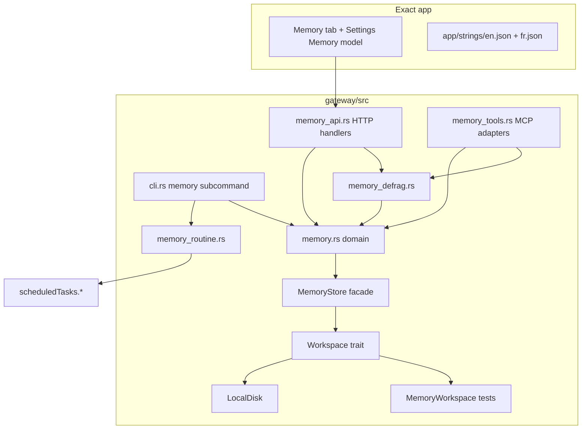
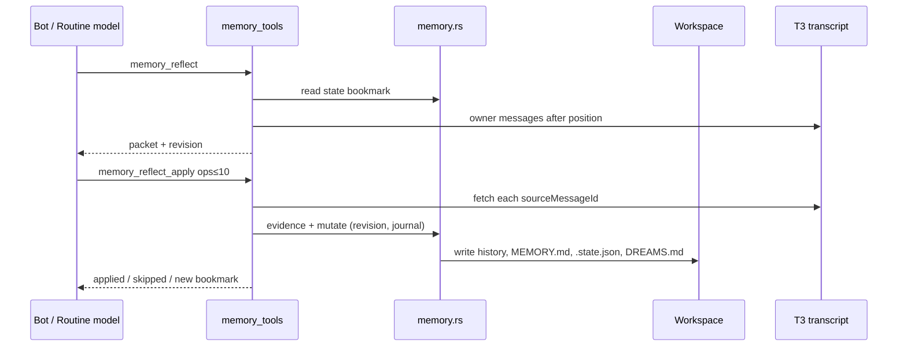

# hbots memory store + maintenance

## Context injection

Injection reads `memory/MEMORY.md`, `memory/log.md`, and `.botapp/shared-memory.md` through `gateway/src/agent_context.rs`, because `memory.rs` does not exist yet. The text is the managed block of `AGENTS.md`. Threads that are not a Bot's are not touched, and an ephemeral child thread inherits nothing unless it starts in that folder. See `docs/architecture.md`.

| Field | Value |
|---|---|
| Author | TBD |
| Date | 2026-11-10 |
| Status | Approved |
| Prior art | threebot PR [#40](https://github.com/RokaSwK/threebot/pull/40) head `91ff27f655bc57326524a7dc5999e6360c81f271` |
| Related | `docs/backends.md` (Workspace seam), `docs/architecture.md`, `docs/PLAN.md` |

## Overview

hbots today creates `memory/MEMORY.md`, `memory/log.md`, and `.botapp/shared-memory.md` on Bot create (`gateway/src/bots.rs`) and exposes read-only `memory_read` / `skills_read` MCP tools that talk to disk with `tokio::fs` (`gateway/src/memory_tools.rs`). There is no write path, no notes tree, no reflection bookmark, no defrag, no Memory UI, and no `/api/memory` routes.

This design ports the full memory maintenance surface from threebot PR #40 into Rust, **except** auto-enrolling every Bot at gateway startup or during provision. Maintenance stays opt-in per Bot. Every memory read and write goes through the existing `Workspace` trait (`gateway/src/workspace.rs`), never through direct filesystem calls from memory modules, so a future non-file Workspace can host the same logical keys.

## Background & Motivation

### Current state

| Piece | Today |
|---|---|
| Create | `Bots::create` writes MEMORY.md / log.md / shared-memory.md with `tokio::fs` |
| MCP | `memory_read`, `skills_read` only; Path-based, FILE_CAP 16 KiB |
| Workspace | `LocalDisk` + test `MemoryWorkspace`; used by `library::Library` |
| Routines | `routines.rs` wraps T3 `scheduledTasks.*`; `new_routine` binds `threadId` to the Bot main thread |
| Settings | `defaultModel`, `avatarDrawingModel` in `settings.json` |
| AGENTS.md | Static Memory section in `render_agents_md`; the Bot prompt is the managed block (`docs/architecture.md`); no `<memory>` snapshot |

### Pain points

1. Bots cannot persist durable facts through tools; the template tells them to keep MEMORY.md current but there is no safe write API.
2. There is no way to mine older owner messages for facts (chat-time edit only sees the latest message in threebot's foundation; reflection is the fix).
3. Manual Markdown edits and model free-rewrites are unsafe: revision races, no provenance, no tombstones, no recovery journal.
4. `memory_tools.rs` bypasses Workspace, which breaks the backends plan (`docs/backends.md` phase 6) and blocks in-memory tests of write logic.

### Why port PR #40 (minus auto-enroll)

PR #40 already ships reflection, defrag policy, note split/merge, a dedicated-thread maintenance routine, Settings `memoryReflectionModel`, CLI, HTTP API, and UI. Review on that PR correctly required opt-in enrollment and fixed five bugs (merge target preservation, `targetDir` traversal, shared retire path, bookmark validation, concurrent `ensureMemoryRoutine`). hbots adopts that fixed shape: tools + opt-in routine, no gateway-wide enroll.

## Goals & Non-Goals

### Goals

1. Durable fact/note store with categories, `@valid` ranges, provenance, revisions, tombstones, history preimages, recovery journals, and owner-quote evidence checks.
2. MCP tools: extended `memory_read`, `memory_edit`, `memory_forget`, `memory_search`, `memory_reflect`, `memory_reflect_apply`, `memory_defrag`, `memory_note_split`, `memory_note_merge` (keep `skills_read` as today, migrated to Workspace).
3. Bounded `<memory>` snapshot in AGENTS.md.
4. Opt-in T3 routine titled "Memory maintenance" on a dedicated thread (`threadId: null`, `threadMode: continue`), daily 03:30 default, using only `memoryReflectionModel`.
5. Settings Memory model picker; clearing it disables maintenance and does not create/enable routines; existing disabled routines stay disabled.
6. CLI `hbots memory reflect|status|disable|defrag <bot>` with `--run` / apply-safe / retire-closed flags.
7. App API and Exact Memory UI + chrome strings (en/fr).
8. **Hard constraint:** all memory I/O through Workspace (or a thin `MemoryStore` that only talks to Workspace).

### Non-goals

- Auto-enrolling every Bot at gateway startup or during provision (including from journal-recovery boot hooks).
- Falling back to the Bot's main chat model for maintenance.
- Binding the maintenance routine to the Bot's main chat thread.
- Letting the model free-rewrite Markdown for tidy.
- Replacing normal Bot routines' model selection with the memory model.
- Migrating all of `bots.rs` / attachments / AGENTS harness rewrites off raw fs in this work.

**Hard-constraint carve-in (not a non-goal):** Bot create's bootstrap of `memory/MEMORY.md`, `memory/log.md`, and `.botapp/shared-memory.md` **must** move onto `MemoryStore` / Workspace in the same PRs that introduce those keys for writes (PR 2/3). Create order:

1. `ensure_bot_dir(slug)` → `write_text_if_absent` MEMORY.md and log.md (fresh slug; if-absent is fine).
2. **Required** `ws.ensure_dir(".botapp")` (Symlink/File → Err, same as Bot roots).
3. `write_text_if_absent` shared-memory.md with the default header — **never** unconditional `write_text`, so Bot B create cannot wipe Bot A's shared facts.

Do not call `require_bot_dir` before the Bot folder exists. Leaving create on `tokio::fs` permanently is not allowed. Other `bots.rs` paths (bot.json, AGENTS.md harness files outside the `<memory>` refresh path) may stay on raw fs until a later backends phase.

## Proposed Design

### Module map



| Module | Role |
|---|---|
| `gateway/src/memory.rs` | Domain: parse/format facts, evidence, mutate, state, snapshot, search, split/merge, dedupe, retire. Public API uses logical relative keys and `MemoryStore`, never `PathBuf` for Bot content. |
| `gateway/src/memory_defrag.rs` | Audit plan writer; orchestrates safe-dedupe and retire-closed over bot + shared scopes. |
| `gateway/src/memory_tools.rs` | MCP tool defs + dispatch. Thin adapter: resolve caller from `threadId` + roster (existing hbots identity), call domain. Migrate memory reads/writes off `tokio::fs` via MemoryStore. Keep `skills_read` here for mcp.rs churn; skills I/O uses Workspace directly (or a tiny `skills_paths` helper), **not** MemoryStore fact/note APIs. |
| `gateway/src/memory_routine.rs` | `MEMORY_ROUTINE_TITLE`, prompt, `ensure_memory_routine`, status/disable/runNow, in-flight dedupe map. Uses existing `routines::{list, change}` / T3 RPC and `tasks_for_bot`. |
| `gateway/src/memory_api.rs` (or handlers in `main.rs` that call domain) | `GET/POST /api/memory*` behind normal auth. |
| `gateway/src/cli.rs` | `hbots memory …` subcommand (loads Config + Workspace + T3; extends `parse_args` value flags). |
| `app/` | Settings picker; fourth BotPanel Memory tab; strings. |
| `bots.rs` | Create bootstraps memory keys via MemoryStore; `write_instructions` / `refresh_agents` inject `<memory>` from snapshot. |

Hook sites (small, marked): `main.rs` (routes + `AppState.workspace` / `MemoryStore`), `mcp.rs` (tool list/dispatch already routes memory tools).

### Workspace usage pattern (hard constraint)

Today `AppState` constructs one `LocalDisk` and hands it only to `Library` (`main.rs` ~185). Promote a shared handle:

```rust
// AppState
pub workspace: Arc<dyn Workspace>,
pub memory: memory::MemoryStore, // or construct MemoryStore::new(workspace.clone()) at call sites
```

`Library::new` and `MemoryStore::new` both take `workspace.clone()`.

#### Trait extensions

`Workspace` today: `read`, `write`, `list`, `remove`, `root_for_harness`. Add **required** methods per backend. Do **not** ship an `exists` default that does `read` then `list`: on LocalDisk, `tokio::fs::read` of a directory fails with `ErrorKind::IsADirectory` (not `NotFound`), so that default would return `Err` for a real directory such as `{slug}/memory/notes`.

```rust
#[async_trait]
pub trait Workspace: Send + Sync {
    async fn read(&self, rel: &str) -> io::Result<Vec<u8>>;
    async fn write(&self, rel: &str, bytes: &[u8], mode: Option<u32>) -> io::Result<()>;
    async fn list(&self, rel: &str) -> io::Result<Vec<DirEntry>>;
    async fn remove(&self, rel: &str) -> io::Result<()>;
    fn root_for_harness(&self, slug: &str) -> String;

    /// True when the key exists as a file or directory. Missing is Ok(false).
    async fn exists(&self, rel: &str) -> io::Result<bool>;

    /// Kind without following a final symlink. Missing → None.
    async fn symlink_kind(&self, rel: &str) -> io::Result<Option<EntryKind>>; // File | Dir | Symlink

    /// Existing directory only. Symlink / file / missing → Err (NotFound or InvalidInput).
    /// LocalDisk: symlink_metadata + is_dir + canonicalize under root (fs stays in LocalDisk).
    /// MemoryWorkspace: prefix/map Dir semantics; never Symlink.
    async fn require_dir(&self, rel: &str) -> io::Result<()>;

    /// Ensure a real directory at `rel`. Missing → create; already Dir → Ok;
    /// Symlink or file → Err. LocalDisk: create_dir_all then same containment as require_dir.
    /// MemoryWorkspace: mark the prefix as a directory (e.g. empty marker key or dir set).
    async fn ensure_dir(&self, rel: &str) -> io::Result<()>;
}
```

| Backend | `exists` / `symlink_kind` / `require_dir` / `ensure_dir` |
|---|---|
| `LocalDisk` | `symlink_metadata` / `try_exists` after `safe_rel`; `require_dir` = Dir + `canonicalize` under root; `ensure_dir` = create_dir_all when missing, then `require_dir`; Symlink/File → Err |
| `MemoryWorkspace` | map hit → File, prefix → Dir; `require_dir` needs Dir semantics; `ensure_dir` records a directory prefix so later `require_dir` succeeds; never Symlink |

Unit tests (both backends): file present, directory present, missing → `exists` false / `require_dir` Err, escape → Err, `ensure_dir` then `require_dir` Ok, Symlink (LocalDisk) → `require_dir`/`ensure_dir` Err.

Do **not** add `rename` unless a concrete need appears; `LocalDisk::write` already uses `store::write_atomic` (temp + rename). Journals recover incomplete multi-file ops.

`safe_rel` already rejects `..`, absolute paths, empty segments. Memory path helpers compose only safe relative keys.

**Note on `docs/backends.md`:** that plan names the method `write_atomic`; the live trait method is `write` (LocalDisk calls `store::write_atomic` inside). Implementers trust `workspace.rs` over the plan wording.

#### Symlink policy (critical for PR 2)

Today's `memory_tools.rs` refuses leaf symlinks via `symlink_metadata`, skips symlink skill entries, and **`folder()`** (`memory_tools.rs` ~113–136) requires the **slug directory itself** to be a real directory (`symlink_metadata` + `is_dir()`, false for a symlink even when the target is a directory), then `canonicalize`s and insists the result stays under `bots_root`. **`LocalDisk::{read,list}` follow symlinks today** (`tokio::fs::read` / `metadata`). Leaf-only checks are not enough: if `{root}/ada` is a symlink to `{root}/bea`, `lstat(ada/memory/MEMORY.md)` sees a regular file (intermediate symlink followed) and reads bea's bytes.

**Chosen approach (b):** keep `LocalDisk::{read,list}` behaviour unchanged for Library, and make memory/skills I/O symlink-safe **on Workspace / MemoryStore** (still relative keys; no absolute PathBuf in the public memory API; no raw `tokio::fs` from memory modules):

1. **Required** `symlink_kind`, `require_dir`, and `ensure_dir` on the trait (see Trait extensions). Canonicalize-under-root lives **only inside `LocalDisk::require_dir` / `ensure_dir`**, never in MemoryStore.

2. **Bot-folder helpers on MemoryStore** (and the skills helper)—thin wrappers after `valid_slug`; they only call Workspace:

```rust
/// Normal tools/API/CLI: existing Bot only. Calls ws.require_dir(slug).
/// Symlink / file / missing → Absent (mirrors folder()).
async fn require_bot_dir(&self, slug: &str) -> Result<(), MemoryScopeError>;

/// Create / bootstrap only. Calls ws.ensure_dir(slug) then ensure nested
/// memory/ (and callers may ensure library/skills via Workspace too).
/// Symlink / file → Err; missing → created. Then require_dir semantics hold.
async fn ensure_bot_dir(&self, slug: &str) -> Result<(), MemoryScopeError>;
```

   - **Every slug-scoped tool/API/CLI read or write** calls `require_bot_dir` before leaf I/O.
   - **`Bots::create` bootstrap** (preserves today's `write_if_missing` for shared):
     1. `ensure_bot_dir(slug)` (ensures `{slug}` and `{slug}/memory`).
     2. `write_text_if_absent` for `{slug}/memory/MEMORY.md` and `log.md`.
     3. **Required** `ws.ensure_dir(".botapp")` — not optional; refuses a symlinked `.botapp` the same way Bot roots are refused.
     4. `write_text_if_absent` for `.botapp/shared-memory.md` only (default `# Shared facts (all Bots)\n\n`). Creating a second Bot must leave an existing shared file unchanged.
   - Do **not** implement canonicalize or `create_dir_all` inside MemoryStore / `memory.rs` with raw fs or by downcasting `Arc<dyn Workspace>`.

3. **Leaf checks:** `MemoryStore::read_text` / note walks / skills listing: if `symlink_kind` on the leaf is `Symlink` or unexpected, treat as empty / skip. Writes refuse to overwrite through a symlink.

4. Tests: keep existing leaf-symlink tests green; **add** `ada` → symlink to `bea` (require_bot_dir Absent, no cross-Bot bytes); **add** fresh-slug bootstrap via `ensure_bot_dir` then MEMORY write on both LocalDisk and MemoryWorkspace; **add** Bot A seeds shared text, Bot B create leaves that text unchanged; **add** symlinked `.botapp` → `ensure_dir` Err.

Do not change Library's symlink behaviour in this work unless a measured regression forces it (approach a).

#### MemoryStore facade

```rust
pub struct MemoryStore {
    ws: Arc<dyn Workspace>,
}

impl MemoryStore {
    pub fn new(ws: Arc<dyn Workspace>) -> Self { Self { ws } }

    pub fn bot_memory(slug: &str) -> String { format!("{slug}/memory/MEMORY.md") }
    pub fn bot_state(slug: &str) -> String { format!("{slug}/memory/.state.json") }
    pub fn bot_log(slug: &str) -> String { format!("{slug}/memory/log.md") }
    pub fn bot_dreams(slug: &str) -> String { format!("{slug}/memory/DREAMS.md") }
    pub fn bot_note(slug: &str, under_notes: &str) -> String { /* memory/notes/... */ }
    pub fn bot_history_dir(slug: &str) -> String { format!("{slug}/memory/history") }
    pub fn bot_journal_dir(slug: &str) -> String { format!("{slug}/memory/.journal") }

    pub fn shared_memory() -> &'static str { ".botapp/shared-memory.md" }
    pub fn shared_state() -> &'static str { ".botapp/shared-memory.state.json" }
    pub fn shared_history_dir() -> &'static str { ".botapp/shared-memory.history" }
    pub fn shared_journal_dir() -> &'static str { ".botapp/shared-memory.journal" }
    pub fn shared_retired(month: &str) -> String { format!(".botapp/shared-history/closed-{month}.md") }

    pub async fn require_bot_dir(&self, slug: &str) -> Result<(), MemoryScopeError> { /* valid_slug; ws.require_dir(slug) */ }
    pub async fn ensure_bot_dir(&self, slug: &str) -> Result<(), MemoryScopeError> { /* valid_slug; ws.ensure_dir(slug); ws.ensure_dir("{slug}/memory") */ }

    pub async fn read_text(&self, rel: &str) -> io::Result<String> { /* utf-8 lossy or strict */ }
    pub async fn read_text_or_empty(&self, rel: &str) -> io::Result<String> { /* NotFound -> "" */ }
    pub async fn write_text(&self, rel: &str, text: &str, mode: Option<u32>) -> io::Result<()> {
        self.ws.write(rel, text.as_bytes(), mode).await
    }
    /// Create-if-absent (today's write_if_missing). Ok(false) if the key already exists as a file.
    /// Refuses if the key is a Symlink. Used for MEMORY.md, log.md, and shared-memory.md on Bot create.
    pub async fn write_text_if_absent(&self, rel: &str, text: &str, mode: Option<u32>) -> io::Result<bool> {
        /* symlink_kind / exists; if missing → write_text, Ok(true); if File → Ok(false); Symlink → Err */
    }
}
```

**Rule:** `memory.rs`, `memory_defrag.rs`, and memory paths in `memory_tools.rs` accept `&MemoryStore` (or `&dyn Workspace` via the facade). They never call `tokio::fs`, `std::fs`, or `store::read_json`/`write_json` on absolute Bot paths, and they never downcast Workspace to reach LocalDisk. Slug-scoped tool/API/CLI ops call `require_bot_dir` → `Workspace::require_dir`. Create/bootstrap: `ensure_bot_dir` → `write_text_if_absent` for MEMORY/log → **required** `ensure_dir(".botapp")` → `write_text_if_absent` for shared-memory.md. Ordinary mutations use unconditional `write_text` (revision-checked). Skills use `&dyn Workspace` + the same require/ensure + leaf `symlink_kind`, not MemoryStore fact APIs. Until create migrates in PR 2/3, treat it as a tracked temporary exception with key-string parity tests—do not leave the exception open after write tools ship.

Atomicity: LocalDisk `write` → `store::write_atomic`. Multi-key mutations (MEMORY.md + state + history note) write a journal entry first, then files, then remove the journal (threebot `writeJournal` / `recoverMemoryJournals`). Document for future backends: either provide compare-and-swap / transactional multi-key write, or honor the same journal recovery protocol on open.

#### Per-store write lock

Serialize writes per logical store (`bot:{slug}` and `shared`) with an async mutex map on `MemoryStore`, matching threebot's "one write at a time so a stale revision always conflicts."

### Logical on-disk layout

```
{bots_root}/
  .botapp/
    shared-memory.md
    shared-memory.state.json
    shared-memory.history/     # preimages of shared MEMORY (pruned)
    shared-memory.journal/     # recovery journals
    shared-history/            # retired closed shared facts (NOT pruned with preimages)
      closed-YYYY-MM.md
  {slug}/
    memory/
      MEMORY.md
      log.md
      DREAMS.md                # human review log; not a memory source
      .state.json              # revisions, provenance, forgotten, reflection bookmark, temporal
      history/                 # preimages before mutations
      .journal/                # recovery journals
      notes/
        …/*.md                 # long-form notes (depth ≤ 2 under notes)
        defrag/YYYY-MM-DD.md   # audit plans; excluded from note index
        history/closed-YYYY-MM.md
        archive/…              # raw sources after merge
    skills/
    AGENTS.md                  # managed block includes <memory> snapshot
```

#### `.state.json` (version 1)

```json
{
  "version": 1,
  "revisions": { "memory/MEMORY.md": "<sha256 of normalized text>", "memory/notes/….md": "…" },
  "provenance": {
    "<sha256 of normalized fact text>": {
      "author": "<slug or user>",
      "sourceMessageId": "…",
      "quote": "…",
      "at": "ISO-8601"
    }
  },
  "forgotten": ["<fact hashes>"],
  "reflection": {
    "lastPosition": null,
    "lastMessageId": null,
    "at": null
  },
  "temporal": {}
}
```

Shared state lives at `.botapp/shared-memory.state.json` with the same shape (no reflection bookmark required on shared; reflection is per-Bot).

#### Fact line shape

```
- [category] @valid[from,to) text [[link]] [source: thread/msg; added: YYYY-MM-DD]
```

Categories (advisory): preference, decision, commitment, person, project, lesson, fact, risk, question. Limits mirror threebot `MEMORY_LIMITS` (snapshot 80/3000 bot, 12/800 shared; file 120/6000; fact 200 chars; notes 20 × 8000 chars, depth 2).

### Data flow



### Reflection invariants

1. Bookmark is `{ lastPosition, lastMessageId, at }` in bot `.state.json`. **`lastPosition` is the index in the filtered owner stream** defined below (0-based, dense, stable for a given projection ordering). Do not store T3-native `ordinal` or other harness fields unless a later fixture audit proves they are stable owner-only positions; hbots fixtures often omit `createdBy` / `creationSource` on read-back.
2. **Owner filter** (do **not** reuse `chat::transcript` messages unfiltered). Build the stream from the main-thread projection's turn items:
   - Include: `type == "user_message"`, no `scheduledTaskId`, no `senderThreadId` (peer/group frames), and not agent/server routine authorship when those fields are present (`createdBy == "user"` / `creationSource` in `{web,…}` when set on outbound sends).
   - Exclude: assistant messages; items that only exist as routine prompts; framed computer/group prompts already stripped by `without_group_turns` where applicable.
   - **Correction:** `chat.rs` still puts `scheduledTaskId` `user_message` items into the **messages** array as `role: "user"` while also emitting a "Routine ran" event. Those must be excluded explicitly; they are not "already non-user."
3. `memory_reflect` returns owner messages with `position > bookmark` (default limit 40, max 80), each carrying `{ id, text, position, at }`, plus current bot MEMORY revision and instructions.
4. `memory_reflect_apply`:
   - `operations` length 0..=10; ops ∈ {add, replace, supersede} only (no forget, no note).
   - `throughPosition` must be a non-negative integer; `lastMessageId` must exist in the owner stream; that message's stream `position == throughPosition`; `throughPosition > bookmark`.
   - Each op's `sourceMessageId` must lie in `(bookmark, throughPosition]`; quote re-checked with `check_owner_evidence`.
   - Replace/supersede count ≤ `floor(0.25 * prior_fact_lines)`.
   - Duplicates skip; other mutate failures abort the batch. Partial applies already committed keep their revisions; **bookmark advances only after the full loop succeeds** (matching threebot).
   - **Retry / idempotency (abort-on-conflict, no skip-on-conflict):** On revision conflict or any other mutate error inside the loop, **abort the rest of the batch**; bookmark stays unchanged. Already-committed ops in that partial batch keep their revisions. The model must call `memory_reflect` again and resubmit with the current `expectedRevision`. Do **not** skip-on-conflict inside `reflect_apply` (duplicate skip for `add` remains). The next reflect re-presents the same owner window until a successful full apply advances the bookmark. Regression test: abort after one successful replace (inject conflict on op 2), then a second apply with the fresh revision that completes and advances the bookmark without double-applying the first op.
   - Empty batch still advances bookmark and appends a DREAMS.md line.
5. Ordinary `memory_edit` continues to use latest (or named) owner message evidence from the same owner filter; it must not accept pre-bookmark "old" messages as a substitute for reflect.

Mock T3 fixtures for the reflect PR must include owner messages, a `scheduledTaskId` user_message (must be filtered out), and enough ids/text for quote checks.

### Defrag invariants

| Op | Mutates facts? | Behavior |
|---|---|---|
| `audit` | No | Writes `memory/notes/defrag/YYYY-MM-DD.md` plan; findings only |
| `safe-dedupe` | Yes (lossless) | Removes byte-identical duplicate lines (`trim_end` key). Top-level bullets and indented children use separate scopes; identical children under distinct parents are kept |
| `retire-closed` | Yes (lossless) | Only lines with explicit `@valid[...,to)` where `to < today`; append exact line to `memory/notes/history/closed-YYYY-MM.md` or `.botapp/shared-history/closed-YYYY-MM.md` |

Near-duplicates, contradictions, broken links, orphans, oversized notes stay **proposed**. Defrag/history/archive paths are excluded from the session note index and note cap.

### Note split / merge invariants

- Revision-checked; refuse conflicts.
- `note_target_dir`: normalize, must stay under `memory/notes/`, no `..`, depth cap (two folder levels under notes), same as fixed threebot `noteTargetDir`.
- Split at `##` headings; keep heading-only sections; source becomes an index with `[[part]]` links; archive preimage via history.
- Merge: preserve existing target body at top; archive every source (and prior target version) under `memory/notes/archive/`; leave redirects at old paths; never delete raw text.

### Opt-in routine lifecycle

```mermaid
stateDiagram-v2
  [*] --> NoRoutine
  NoRoutine --> Enabled: CLI reflect / UI Set up\n(ensure_memory_routine; requires model)
  Enabled --> Disabled: CLI disable OR clear Memory model
  Disabled --> Enabled: CLI reflect / setEnabled true\n(model still set)
  Disabled --> Disabled: clear then re-set model\n(stays disabled; no auto re-enable)
  Enabled --> Running: schedule 03:30 or --run
  Running --> Enabled: T3 finishes
```

Constants (from threebot `memory-routine.mts`):

- Title: `"Memory maintenance"` (also recognize legacy `"Memory reflection"` when finding).
- Prompt: reflect → apply (or empty) → defrag audit → safe-dedupe → retire-closed → optional split/merge of clear cases; never delete unique facts or resolve undated contradictions.
- Upsert payload: `threadId: null`, `threadMode: "continue"`, `modelSelection: memoryReflectionModel`, `runtimeMode: "full-access"`, `createdBy: "agent"`, `creationSource: "server"`, `schedule: { type: "fixed_time", timeOfDay: "03:30" }`.
- If an existing task is bound to `mainThreadId` or its modelSelection drifted, delete and recreate (dedicated thread is required for T3 to honor `modelSelection`).
- `ensure_memory_routine`: in-flight `HashMap<slug, JoinHandle/…>` dedupe; omitted `enabled` preserves existing; new routines default enabled **only when the user explicitly opts in** (CLI `hbots memory reflect` or Memory tab **Set up** → `POST /api/memory/routine`), never from gateway boot. UI and CLI share this helper; do **not** use chat-prefill as the primary setup path.
- Clearing `memoryReflectionModel` in Settings: see Settings contract below (best-effort `setEnabled(false)` discovered via `tasks_for_bot` / title+projectId, not via today's `owned_routine`).
- Setting a model again: do not re-enable previously disabled routines.
- Normal Bot routines (`routines::new_routine`) stay on main thread + Bot/default model; memory routine code must not patch them.
- **Never** call `ensure_memory_routine` from `hbots serve` boot, provisioner, or journal recovery.

### Bot routine ownership helper

Today `bot_routines` and `owned_routine` (`main.rs` ~1477–1528) use only `tasks_for_thread(doc, mainThreadId)`. A memory routine with `threadId: null` will not list and cannot be enabled/disabled/deleted/run through `/api/bots/{slug}/routines*` ("That routine is not on this Bot.").

Add one helper and use it everywhere ownership matters:

```rust
/// Main-thread tasks for this Bot, plus Memory maintenance (and legacy title) tasks for its projectId.
pub fn tasks_for_bot(doc: &Value, bot: &Value) -> Vec<Value>;

pub fn is_memory_routine_title(title: &str) -> bool {
    title == "Memory maintenance" || title == "Memory reflection"
}
```

- `tasks_for_bot` = `tasks_for_thread(doc, mainThreadId)` ∪ tasks where `projectId == bot.projectId` and `is_memory_routine_title(title)` (threadId may be null).
- Wire into: `bot_routines` list, `owned_routine`, Settings clear-model disable-all, CLI `status` / `disable` / `run`.
- `new_routine` for ordinary routines stays main-thread-bound; Memory tab / CLI use `memory_routine::ensure_memory_routine` instead of `new_routine`.

### AGENTS.md snapshot

**Call path:**

1. `render_agents_md(bot, …, snapshot: &MemorySnapshot)` (or a sibling that accepts the rendered `<memory>` block) embeds `memory::render_memory_block(snapshot)` inside the managed markers. Keep a human-readable shared-memory path mention stable in the prose section.
2. `Bots` gains access to `MemoryStore` (cloned Arc on `Bots` or passed into `write_instructions` / new `refresh_agents(slug)`). Today `Bots` only has `root: PathBuf` and uses raw fs for AGENTS.md; the snapshot **read** must go through MemoryStore even if the AGENTS.md write remains on fs until a later backends pass.
3. After successful mutate / forget / defrag / split / merge, tools/API call `bots.refresh_agents(slug)` → `read_snapshot` via MemoryStore → `merge_managed` into AGENTS.md. Also refresh inside `write_instructions` so provision/reconcile picks up memory.
4. Land template bullets (reflect / defrag / split-merge from threebot `bot-template.mts`) in the **same** PR as the snapshot wiring so AGENTS never advertises tools that are not shipped.

### Caller identity (hbots vs threebot)

threebot uses per-Bot MCP bearer. hbots `memory_tools` resolves the Bot from `threadId` → roster `mainThreadId` and ignores forged slugs. **Keep that hbots pattern** for all new tools: identity from the calling thread, not from model-supplied slug.

**Subagent write rule (decided):** Callers with `role == "subagent"` or `hideFromSidebar` may mutate **only their own** `{slug}/memory/` store. `scope: "shared"`, parent-folder paths, and any write that would touch `.botapp/shared-memory.md` or the parent's MEMORY/notes are **refused**. `memory_read` of the parent (and shared, read-only) stays as today. Top-level Bots may write bot + shared with evidence as usual.

Reflection message source: `memory_reflect` adapter over `state.t3` projection fetch + the **owner filter and stream positions** in Reflection invariants (not raw `chat::transcript`). Subagent reflect/reflect_apply target the subagent's own bookmark and MEMORY only.

## API / Interface Changes

### MCP tools (`POST /mcp/bot`)

| Tool | Notes |
|---|---|
| `memory_read` | Extended: scopes bot/shared/all; `topic` + `full` for one note; notes index; revisions; keep FILE_CAP or raise for `full` note reads (threebot uses 100k for full). Parent memory for subagents on read. |
| `memory_edit` | op add/replace/supersede/note; `expectedRevision`; `sourceQuote`; evidence. Subagents: own store only; refuse `scope: shared` and parent paths. |
| `memory_forget` | tombstone + remove line. Subagents: own store only; refuse shared/parent. |
| `memory_search` | query over MEMORY, shared, notes (reads; subagents may search parent+own+shared as read tools allow) |
| `memory_reflect` | packet after bookmark (own store bookmark) |
| `memory_reflect_apply` | batch ≤10; strict bookmark fields. Subagents: own store only. |
| `memory_defrag` | op audit \| safe-dedupe \| retire-closed. Subagents: own store only; refuse shared scope. |
| `memory_note_split` / `memory_note_merge` | as above. Subagents: own notes only. |
| `skills_read` | unchanged behaviour; Workspace + skills path helper (not MemoryStore) |

### HTTP (auth required)

| Method | Path | Body / query | Result |
|---|---|---|---|
| GET | `/api/memory?slug=` | | Memory view: bot/shared facts, provenance, notes, forgotten count, limits, reflection bookmark summary |
| GET | `/api/memory/note?slug=&path=` | | Note text + revision |
| POST | `/api/memory/forget` | `{ slug, scope, fact, expectedRevision }` | Trusted user forget (no transcript quote; `trustedUser: true`) |
| POST | `/api/memory/defrag` | `{ slug, applySafe?, retireClosed? }` | Always audits; optional safe/retire |
| POST | `/api/memory/note/split` | `{ slug, path, expectedRevision, targetDir? }` | |
| POST | `/api/memory/note/merge` | `{ slug, path, expectedRevision, sources[], description? }` | |
| POST | `/api/memory/routine` | `{ slug, enabled?, timeOfDay?, run?: bool }` | Opt-in ensure / enable / runNow via `memory_routine` (requires `memoryReflectionModel`); status also visible through `tasks_for_bot` on routines list |

### Settings

- Add `memoryReflectionModel: null | { instanceId, model, effort? }` beside `defaultModel` in `settings_defaults`.
- **PUT `/api/settings` validation:**
  - If the key is present and is an **object**, run `checked_selection` (same as `defaultModel`) and store the normalized selection.
  - If the key is present and is **`null`**, clear the setting (disable path below).
  - If the key is present and is any other JSON type (string, array, number, bool), **400**.
  - If the key is **absent**, leave the current value unchanged (shallow merge as today).
- **Clear side effect:** after validating the patch and **before or after** writing `settings.json` (pick: **write settings first**, then best-effort disable so a T3 outage cannot block saving the cleared model):
  1. `routines::list` once.
  2. For each Bot with a `projectId`, find tasks via title + `projectId` (`is_memory_routine_title`).
  3. `scheduledTasks.setEnabled { id, enabled: false }` per task; log/trace per-failure; continue the loop.
  4. HTTP 200 with saved settings even if some disables failed (surface counts in logs; optional `warnings` array later—not required for v1).
- Re-setting a model does **not** create or re-enable routines.
- Origin / `require_json` unchanged (existing `/api/` middleware).

### CLI

```
hbots memory reflect <bot> [--time HH:MM] [--run] [--enable|--disable]
hbots memory status <bot>
hbots memory disable <bot>
hbots memory defrag <bot> [--apply-safe] [--retire-closed]
```

**Execution path (no running gateway required for reflect/defrag domain work):**

1. Extend top-level `cli::run` match with `"memory" => memory_command(&flags, &rest).await`.
2. HELP gains a `memory` section.
3. `parse_args`: add `"time"` (and if needed `"apply-safe"` is boolean-only) to the value-taking whitelist beside `"port" | "t3-url"`. Today only those two consume a following argv token; without this, `--time 03:30` sets `time=true` and pushes `03:30` into `rest`. Boolean flags (`--run`, `--apply-safe`, `--retire-closed`, `--enable`, `--disable`) already work as `has(...)`.
4. `memory_command` loads `config::Config::from_env()`, builds `LocalDisk` / `MemoryStore`, `t3::T3`, and reads settings for `memoryReflectionModel`—same domain modules as the gateway process. Prefer this over HTTP to a live `hbots serve` so CLI works during bring-up; optional later: `--via-http` for remote homes.
5. `reflect` creates/updates the opt-in routine when the model is set; `--run` → `scheduledTasks.runNow`. `defrag` calls domain/defrag directly (audit always; flags apply safe/retire).

### Routines API interaction

Reuse `/api/bots/{slug}/routines*` with **`tasks_for_bot`** (see Bot routine ownership helper). List, enable, disable, delete, and runNow all go through that helper so null-`threadId` memory routines are first-class. Ordinary `new_routine` remains main-thread-bound.

## Data Model Changes

No SQL. Additive files under existing Bot folders. Migration for existing Bots:

1. Missing `.state.json` → empty state on first read (no error).
2. Missing `notes/`, `history/`, `.journal/`, `DREAMS.md` → created on first need via Workspace write (parents created by LocalDisk atomic write).
3. Existing MEMORY.md / log.md / shared-memory.md left intact for old homes. Create path for **new** Bots: `ensure_bot_dir` → if-absent MEMORY/log → `ensure_dir(".botapp")` → if-absent shared-memory.md (same keys). Multi-create must not clobber shared.
4. No automatic routine creation.
5. `recover_memory_journals` on gateway start for leftover `.journal` entries. **Slug discovery:** use `Bots::list` / roster (existing Bot records; may still use raw fs outside the memory I/O rule). **Do not** add Workspace root `list("")` in this work (`safe_rel` rejects empty/`"."`). For each known slug, journal file I/O uses Workspace `list`/`read`/`write`/`remove` on `{slug}/memory/.journal/…`; shared journals use `.botapp/shared-memory.journal/…`. **Acceptance:** must not call `ensure_memory_routine`, touch Settings, or enroll Bots.

## Alternatives Considered

### 1. Keep direct `tokio::fs` in memory modules (reject)

Faster to port line-by-line from Node, but violates the backends Workspace seam, blocks `MemoryWorkspace` unit tests for mutations, and duplicates path-escape logic already in `safe_rel`. **Rejected** by hard constraint.

### 2. Auto-enroll every Bot when Memory model is set (reject for hbots)

threebot originally enrolled at startup; review required opt-in. A full-access overnight job on every Bot is surprising. hbots ships tools + explicit CLI/UI enable only. **Out of scope.**

### 3. Bind maintenance to the main chat thread

Simpler upsert, but T3 ignores `modelSelection` on bound threads, so the cheap memory model would not apply and the main conversation would be polluted. **Rejected**; dedicated thread is required.

### 4. SQLite / DB-backed facts instead of Markdown

Better queryability, worse human readability and home-dir compatibility (`tests/compat`). Markdown + `.state.json` matches threebot and the product ask. A future Workspace could map the same keys to blobs without changing tool contracts.

## Security & Privacy Considerations

| Threat | Mitigation |
|---|---|
| Path traversal (`targetDir`, note path, slug) | `safe_rel` + note path normalizer; refuse `..`; depth caps |
| Prompt injection into MEMORY / AGENTS | Ported `check_fact` / note checks (see port map): instruction phrases, managed markers, prompt links, hidden bidi chars |
| Secrets in memory | Ported secret/Luhn/opaque-run refusal; Vault remains the only secret store |
| Forged identity | Ignore model-supplied slug; bind tools to roster via `threadId` |
| Evidence forgery | Ported `typed_runs` + `check_owner_evidence`; strip fences, quotes, forwards; min phrase length; no acknowledgements-only |
| Shared memory cross-Bot | Shared writes still need owner evidence; HTTP forget is trusted signed-in user (`trustedUser`) and skips quote checks |
| Symlink escape | `require_bot_dir` → `Workspace::require_dir` (LocalDisk: Dir + canonicalize-under-root inside LocalDisk); create uses `ensure_bot_dir` → `ensure_dir`; leaf `symlink_kind` refuse; no raw fs in MemoryStore |
| Routine full-access | Opt-in only; uses memory model; prompt forbids free rewrite |

### Port map (threebot → hbots)

| threebot (`server/memory.mts` unless noted) | hbots module | Enforced on |
|---|---|---|
| `checkFact`, `secretReason` / Luhn / opaque run | `memory.rs` | MCP edit/forget/reflect_apply; HTTP note writes; not on trusted HTTP forget body beyond fact-line presence |
| `checkOwnerEvidence`, `typedRuns` | `memory.rs` | MCP edit/forget/reflect_apply only (HTTP forget uses `trustedUser`) |
| `sanitizeMemoryText`, managed markers, `<memory>` escape | `memory.rs` | Snapshot render + note/fact writes |
| `normalizeNotePath`, `noteTargetDir` | `memory.rs` | MCP + HTTP split/merge/note read |
| `mutateMemory`, journals, history, tombstones | `memory.rs` | All writers |
| `dedupeExactFacts`, `retireClosedFacts` | `memory.rs` | defrag ops |
| `splitMemoryNote`, `mergeMemoryNotes` | `memory.rs` | MCP + HTTP |
| `analyzeMemoryStore` / plan writer (`memory-defrag.mts`) | `memory_defrag.rs` | MCP + HTTP defrag |
| `ensureMemoryRoutine` (`memory-routine.mts`) | `memory_routine.rs` | CLI + Memory UI primary "Set up" (direct ensure / `/api/memory/routine`; not chat prefill) |
| Tool schemas (`memory-mcp.mts`) | `memory_tools.rs` | MCP |

## Observability

- `tracing::info` on mutate / forget / reflect apply / defrag with slug, op, counts (never log raw secrets or full MEMORY bodies at info).
- DREAMS.md append for reflect and significant defrag (human-readable).
- Routine lastRun* from T3 subscribe snapshot for `hbots memory status` and UI.
- Metrics (optional later): reflect_applied_total, defrag_removed_total, memory_conflict_total.

Latency targets (local disk): mutate p99 &lt; 50 ms for typical MEMORY.md (&lt; 6 KiB); reflect packet build dominated by T3 projection fetch (reuse chat path; bound messages).

Storage: history prune keep last N preimages (threebot keeps a small set per store); journals deleted after success. Estimate &lt; 1 MiB per active Bot under normal use.

## Rollout Plan

1. Land Workspace `exists` / `symlink_kind` / `require_dir` / `ensure_dir` + shared AppState handle.
2. MemoryStore (`require_bot_dir` / `ensure_bot_dir`) + migrate `memory_read` / `skills_read` + create ensure-then-write bootstrap.
3. Write foundation behind tools; no UI yet; feature usable from MCP in tests.
4. Reflection (owner-stream positions) + defrag + split/merge tools.
5. Opt-in routine + `tasks_for_bot` + Settings key + CLI.
6. HTTP API; then Settings picker (8a), Memory tab (8b), AGENTS snapshot/template (8c).
7. Journal recovery on boot (no enroll) + docs.

Feature flag: not required if stages are PR-gated; optional `beta.memoryMaintenance` only if we need to hide UI while tools ship. Default: ship dark (tools available, routine off until user opts in).

Rollback: revert PRs; leftover `.state.json` / notes are inert; disable routines via CLI; clearing Memory model disables schedules.

## Test Plan

| Layer | Approach |
|---|---|
| Workspace | `exists` / `symlink_kind` / `require_dir` / `ensure_dir` on both backends; LocalDisk symlink Bot root → `require_dir` Err; `ensure_dir` then `require_dir` on fresh slug; MemoryStore must not call canonicalize itself |
| Unit | `MemoryWorkspace` for domain: parseFact, evidence, mutate conflict, forget tombstone, reflect bookmark validation (neg/mismatch/skip ahead), scheduledTaskId excluded from owner stream, abort-on-conflict mid-batch then successful re-apply, safe-dedupe child bullets, retire-closed shared-history path, split targetDir traversal, merge preserves target, heading-only sections |
| Journal | Crash mid-write: leftover journal recovered on `recover_memory_journals` (slugs from `Bots::list`/roster; journal bytes via Workspace); recovery does not enroll routines |
| MCP | Extend `memory_tools` tests (including existing symlink tests); memory via MemoryStore; skills via Workspace helper; subagent own-write ok / shared+parent write refused / parent read ok |
| Create | New Bot MEMORY/log via if-absent; required `ensure_dir(".botapp")`; shared if-absent; Bot A seeds shared, Bot B create leaves it unchanged |
| Routine | Mock T3: upsert shape (`threadId` null), `tasks_for_bot` ownership, concurrent ensure dedupe, clear model save-then-disable, disabled stays disabled |
| CLI | `parse_args` takes `--time 03:30` as a value; boolean flags unchanged |
| HTTP | Handler tests with temp LocalDisk or MemoryWorkspace |
| Compat | Existing MEMORY.md still readable; settings.json gains nullable field |
| e2e | Optional: Memory tab loads; Settings shows Memory model |

Port threebot server tests listed in PR #40 (reflect, defrag, split, merge, mutations) as Rust `#[tokio::test]`.

## Open Questions

None. All product forks are decided.

### Resolved

- **Subagent writes:** Own `memory/` only. Shared and parent are read-only for writes; `memory_read` of parent stays as today.
- **Routine visibility:** Memory maintenance appears in the Routines panel via `tasks_for_bot` **and** on the Memory tab status/setup card (Memory tab owns enable/setup copy).
- **`skills_read` home:** Stay in `memory_tools.rs`; I/O via Workspace / `skills_paths`, not MemoryStore.
- **Memory panel chrome:** Fourth BotPanel tab (`details` \| `library` \| `computer` \| `memory`), including `tabKey` cycle and strip.
- **Memory Set up:** Direct `ensure_memory_routine` (API), not chat prefill.
- **reflect_apply conflicts:** Abort batch; no skip-on-conflict.

PR #40 head `91ff27f` remains the behaviour source for the port.

## Key Decisions

1. **All memory I/O through Workspace / MemoryStore** (including Bot create bootstrap). Create shared-memory uses **write-if-absent** after required `ensure_dir(".botapp")`. Journal recovery discovers slugs via roster/`Bots::list`; journal bytes stay on Workspace. Live trait method is `write`, not the plan's `write_atomic` name.
2. **Opt-in maintenance only.** No gateway, provisioner, or journal-recovery enroll; avoids surprise full-access overnight jobs.
3. **Dedicated routine thread + memoryReflectionModel, never Bot main model fallback.** Required for T3 to honor modelSelection; protects chat cost and context.
4. **Markdown facts + `.state.json` metadata, not a DB.** Human-readable, compat-friendly, matches threebot.
5. **Mechanical tidy only (audit / exact dedupe / dated retire / lossless split-merge).** Model never free-rewrites MEMORY.md.
6. **Strict reflection bookmark validation** using a **filtered owner-stream position**, not raw `chat::transcript` / T3 ordinal. Excludes `scheduledTaskId` user_messages explicitly.
7. **Shared retired facts under `.botapp/shared-history/`, not pruned preimage history.** Fixes threebot bug #3.
8. **hbots tool identity stays threadId→roster.** Do not require threebot's per-Bot bearer for this port.
9. **Promote `AppState.workspace` shared by Library and Memory.** One LocalDisk root; no second filesystem view.
10. **Serialize writes per store.** Stale `expectedRevision` always conflicts.
11. **Symlink safety via Workspace `require_dir` / `ensure_dir`** (canonicalize only inside LocalDisk); MemoryStore `require_bot_dir` for tools, `ensure_bot_dir` for create; then leaf refuse—without changing Library follow behaviour.
12. **`tasks_for_bot` owns list + mutation authorization** for null-threadId memory routines.
13. **Settings clear = save first, best-effort disable;** re-set model does not re-enable.
14. **Memory is a fourth BotPanel tab** (keyboard cycle + strip updated); Settings Memory model ships separately; Memory "Set up" calls `ensure_memory_routine` directly (shared with CLI), not chat prefill.
15. **`memory_reflect_apply` aborts the batch on conflict/error** (no mid-batch skip-on-conflict); bookmark advances only on full success.
16. **Subagents write own memory only.** Callers with `role == "subagent"` or `hideFromSidebar` may `memory_edit` / `forget` / `reflect_apply` / `defrag` / note split/merge only against their own `{slug}/memory/`. Shared and parent writes are refused. Parent (and shared) remain readable via `memory_read` as today.

## References

- threebot PR #40: https://github.com/RokaSwK/threebot/pull/40 (head `91ff27f`)
- threebot modules: `server/memory.mts`, `memory-mcp.mts`, `memory-defrag.mts`, `memory-routine.mts`
- hbots: `gateway/src/workspace.rs` (trait method `write`; atomic on LocalDisk), `memory_tools.rs`, `bots.rs`, `routines.rs`, `library.rs`, `store.rs`, `cli.rs` (`parse_args`), `chat.rs` (transcript + scheduledTaskId), `main.rs` (`owned_routine`, `put_settings`)
- `docs/backends.md` phase 6 (Workspace for bots/attachments); method name `write_atomic` there is aspirational—trust `workspace.rs`
- Chrome strings: `app/strings/en.json`, `app/strings/fr.json`

## Recommended `docs/PLAN.md` blurb

```markdown
### Memory store + maintenance (port threebot PR #40, opt-in)

Port durable Bot memory (facts, notes, provenance, reflection, defrag, note split/merge),
MCP tools, opt-in "Memory maintenance" routine (dedicated thread, Settings Memory model),
CLI, `/api/memory*`, and Exact Memory tab. All memory reads/writes (including Bot create
bootstrap of MEMORY.md / log.md / shared-memory.md) go through the Workspace adapter; no
auto-enroll at startup or from journal recovery. Design: see the memory store design doc.
Files: `gateway/src/memory.rs`, `memory_defrag.rs`, `memory_routine.rs`, `memory_tools.rs`,
`workspace.rs` (`exists` / `symlink_kind` / `require_dir` / `ensure_dir`), hooks in `main.rs` /
`mcp.rs` / `cli.rs` / `routines.rs` (`tasks_for_bot`), `app/` Settings + Memory tab + strings.
```

## PR Plan

Ordered, independently reviewable PRs. Each leaves main buildable and tests green.

### PR 1 — Workspace exists, symlink_kind, require_dir, ensure_dir + shared AppState handle

- **Title:** `workspace: add exists/symlink_kind/require_dir/ensure_dir; expose Arc<dyn Workspace> on AppState`
- **Files:** `gateway/src/workspace.rs`, `gateway/src/main.rs`, `gateway/src/library.rs` (take cloned Arc)
- **Dependencies:** none
- **Changes:** Required `exists`, `symlink_kind`, `require_dir`, `ensure_dir` on both backends. LocalDisk: symlink_metadata + canonicalize-under-root **inside** `require_dir`/`ensure_dir`. MemoryWorkspace: map/prefix Dir; `ensure_dir` makes later `require_dir` succeed; never Symlink. Shared `AppState.workspace`. Unit tests: file, directory, missing, escape, symlink leaf, ensure-then-require, Bot-root symlink → require_dir Err. No Library behaviour change.

### PR 2 — MemoryStore + require/ensure bot dirs; migrate memory_read / skills_read; create bootstrap keys

- **Title:** `memory: MemoryStore facade; Workspace-backed memory_read and skills_read`
- **Files:** `gateway/src/memory.rs` (new: limits, parse, snapshot/state/note read, `require_bot_dir` / `ensure_bot_dir`), `gateway/src/memory_tools.rs`, `bots.rs` create via ensure + MemoryStore, `main.rs` (mod + state.memory), tests
- **Dependencies:** PR 1
- **Changes:** Replace tokio::fs in `memory_read` with MemoryStore. Tools/API call `require_bot_dir` → `ws.require_dir(slug)` before leaf I/O; leaf `symlink_kind` refuse. `skills_read` same require path. Create: `ensure_bot_dir` → `write_text_if_absent` MEMORY/log → **required** `ensure_dir(".botapp")` → `write_text_if_absent` shared-memory.md. Keep leaf symlink tests green; **add** Bot-root symlink regression; **add** fresh-slug bootstrap; **add** Bot A shared seed + Bot B create leaves shared intact; **add** symlinked `.botapp` refused. No write tools yet. No canonicalize/fs inside MemoryStore.

### PR 3 — Write foundation: edit, forget, search, journals, provenance

- **Title:** `memory: mutate, forget, search, history and journals`
- **Files:** `memory.rs` (mutate, evidence port map, history, journal, recover), `memory_tools.rs` (edit/forget/search), tests ported from threebot mutations
- **Dependencies:** PR 2
- **Changes:** Full fact/note write boundary; per-store locks. **Subagent gate:** if caller is `role == "subagent"` or `hideFromSidebar`, `memory_edit` / `memory_forget` (and later reflect_apply / defrag / split / merge in PRs 4–5) target only the caller's own store; refuse `scope: "shared"` and any parent path. `memory_read` of parent unchanged. Tests: subagent edit own ok; subagent shared/parent write error; parent read still works. If create bootstrap was deferred from PR 2, finish it here before edit tools merge. Snapshot render helpers exist but AGENTS wiring waits for PR 8c.

### PR 4 — Reflection tools

- **Title:** `memory: reflect and reflect_apply with owner-stream bookmarks`
- **Files:** `memory.rs` (bookmark helpers), `memory_tools.rs`, owner-stream adapter (not raw transcript), `tests/mock-t3.ts` + fixtures, tests for bookmark validation, scheduledTaskId exclusion, empty batch, abort-after-partial retry
- **Dependencies:** PR 3
- **Changes:** DREAMS.md; 25% replace cap; filtered positions; idempotency notes tested. Subagent `reflect_apply` own-store only (same gate as PR 3).

### PR 5 — Defrag + note split/merge

- **Title:** `memory: defrag audit/safe-dedupe/retire-closed and note split/merge`
- **Files:** `gateway/src/memory_defrag.rs` (new), `memory.rs` (dedupe, retire, split, merge, noteTargetDir), `memory_tools.rs`, tests (child bullets, shared-history path, traversal, merge preserves target, heading-only sections)
- **Dependencies:** PR 3 (PR 4 optional parallel if edit path stable)
- **Changes:** Policy as specified; exclude defrag/history/archive from note index. Subagent defrag/split/merge: own store only; refuse shared (same gate as PR 3).

### PR 6 — Opt-in routine + Settings memoryReflectionModel + CLI + tasks_for_bot

- **Title:** `memory: opt-in Memory maintenance routine, settings, and CLI`
- **Files:** `gateway/src/memory_routine.rs` (new), `routines.rs` (`tasks_for_bot`, title helper), `main.rs` (bot_routines / owned_routine / settings defaults + PUT clear contract), `cli.rs` (memory subcommand, `parse_args` value flag `time`, HELP), mock T3 routine tests
- **Dependencies:** PR 4–5 (prompt calls those tools)
- **Changes:** No startup enroll; concurrent ensure dedupe; save-settings-then-best-effort-disable; dedicated thread upsert; CLI loads Config/Workspace/T3 directly.

### PR 7 — HTTP API

- **Title:** `api: /api/memory routes for view, forget, defrag, note split/merge, routine`
- **Files:** `memory_api.rs` or `main.rs` handlers, auth as other `/api/*`
- **Dependencies:** PR 5 (and PR 3); routine route also needs PR 6
- **Changes:** Trusted-user forget; defrag flags; `POST /api/memory/routine` wraps `ensure_memory_routine` / runNow; Origin/`require_json` consistent with other writes.

### PR 8a — Settings Memory model + chrome strings

- **Title:** `app: Settings Memory model picker and i18n strings`
- **Files:** `app/app.contract`, `app/app.ts`, `app/strings/en.json`, `app/strings/fr.json` (settings keys only)
- **Dependencies:** PR 6 (API field exists)
- **Changes:** Picker beside default model; clear/null UX; no Memory tab yet.

### PR 8b — Exact Memory tab

- **Title:** `app: BotPanel Memory tab`
- **Files:** `app/app.contract`, `app/app.ts`, `app/strings/en.json`, `app/strings/fr.json` (memory.* keys)
- **Dependencies:** PR 7, PR 8a, PR 6 (ensure routine)
- **Changes:** Fourth tab order `details` \| `library` \| `computer` \| `memory`. Update `BotPanel.tabKey` Arrow/Home/End cycle (today End/`Arrow*` hardcode `computer` as last; `app.contract` ~2729–2732 and strip `for t in ["details", "library", "computer"]` ~2820), tab strip, and aria tabpanels. Facts + provenance + notes index; Tidy/Audit card; Remove exact duplicates; Retire closed facts; note split at H2. **Set up routine:** primary button calls `ensure_memory_routine` via a small `POST /api/memory/routine` (or reuse routines upsert through gateway helper)—same codepath as CLI—when `memoryReflectionModel` is set; show status from `tasks_for_bot`. **Not** threebot-style chat prefill. No hardcoded English in contract.

### PR 8c — AGENTS snapshot + template + PLAN blurb

- **Title:** `memory: AGENTS.md memory snapshot and template instructions`
- **Files:** `bots.rs` (`refresh_agents` / `render_agents_md` + MemoryStore), template bullets, `docs/PLAN.md` blurb
- **Dependencies:** PR 3 (domain snapshot), PR 4–5 (tools named in template must exist)
- **Changes:** Wire refresh after mutations; land instructions with snapshot so AGENTS does not advertise missing tools.

### PR 9 — Journal recovery on boot + docs

- **Title:** `memory: recover journals on serve; document Workspace memory keys`
- **Files:** `main.rs` boot hook, `docs/architecture.md` memory section, `docs/backends.md` note that memory is Workspace-native, `docs/PLAN.md`
- **Dependencies:** PR 3
- **Changes:** Best-effort recovery. Slug discovery via `Bots::list` / roster (no Workspace root list; `safe_rel` rejects `""`/`"."`). Journal entries under `{slug}/memory/.journal/` and `.botapp/shared-memory.journal/` read/write/remove via Workspace only. **Must not** call `ensure_memory_routine` or enroll Bots. Architecture paragraph: opt-in maintenance, Workspace hard constraint, shared write-if-absent on create.
