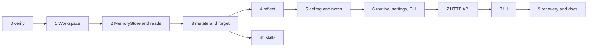

# Plan: build the memory store and skills

| Field | Value |
|---|---|
| Status | Draft execution plan. Nothing here is implemented |
| Date | 2026-11-12 |
| Design it executes | `docs/memory-maintenance.md` (status Approved, dated 2026-11-10) |
| Related | `docs/context-injection-plan.md`, `docs/backends.md`, `docs/webhook-triggers-plan.md`, `docs/reply-images-plan.md` |

`docs/memory-maintenance.md` is the behavior spec. This plan does not repeat it. It does three things the spec could not:

1. Reconciles the spec with the code as it is today (the tree moved since 2026-11-10).
2. Splits the work into phases with files, tests and exit criteria that fit this repo's size rules.
3. Adds the **skills** track, which the spec only covers as "migrate `skills_read` to Workspace".

Facts are marked **[verified]** (read in this tree) or **[unverified]** (needs a Phase 0 check).

## 1. Drift: spec versus tree

The spec names files that no longer exist or have moved. Treat this table as authoritative where it differs.

| Spec says | Tree today **[verified]** |
|---|---|
| `gateway/src/memory_tools.rs` | `gateway/src/bots/memory_tools/mod.rs` and `tests.rs`. Tools: `memory_read`, `skills_read`. `FILE_CAP` 16 KiB. `folder()` does the symlink and canonicalize checks with `tokio::fs`. `is_subagent` and `parent_slug` already exist |
| `gateway/src/workspace.rs` | `gateway/src/storage/workspace.rs` (trait with `read, write, list, remove, root_for_harness`). Adapters in `storage/adapters/{filesystem,memory,anytype}`. `LocalDisk` is `filesystem/local_disk.rs`. The test backend is `adapters/memory.rs` |
| `AppState.workspace` is a new shared handle | `AppState` (`api/state.rs`) has no workspace field. `main.rs:135` builds a private `LocalDisk` inside `Library::new`. The promotion in the spec's PR 1 is still needed |
| `bots.rs` create bootstrap | `gateway/src/bots/lifecycle.rs:263-270`: `write_if_missing` on `memory/MEMORY.md`, `memory/log.md`, `.botapp/shared-memory.md` with raw `tokio::fs`. `Bots` holds only `root: PathBuf` (`bots/mod.rs`) |
| "no `<memory>` snapshot", AGENTS.md has a static Memory section | Snapshot injection **exists**: `bots/agent_context/mod.rs` has `read_snapshot`, `render_snapshot`, tags `memory`, `memory-log`, `shared-memory`, `parent-memory`, byte caps (4, 2, 2, 2 KiB), and a 20-second poller (`POLL_EVERY`) that rewrites the managed block when the files change. It reads files directly with `tokio::fs` and `memory_tools::folder` |
| `routines.rs`, `owned_routine` in `main.rs` | `chat/routines/mod.rs` (`tasks_for_thread`, `new_routine`) and `api/routines_api.rs` (`bot_routines`, `owned_routine`) |
| `cli.rs` `parse_args` | `gateway/src/platform/cli/mod.rs` and `platform/cli/env.rs` |
| `put_settings` in `main.rs` | `gateway/src/api/settings.rs` (patch merge with per-key validation) |
| `mcp.rs` | `gateway/src/platform/mcp.rs`, routing memory tools through `bots::memory_tools::is_memory_tool` |
| Flat files `memory.rs`, `memory_defrag.rs`, `memory_routine.rs` | Rust files are capped at 500 lines (`scripts/check-rs-length.sh`). Use a module directory, see 3.1 |
| Owner-stream fixture note about `scheduledTaskId` | Confirmed: `chat/t3.rs::project_turns` pushes a `scheduledTaskId` `user_message` into `messages` as `role: "user"` **and** emits a "Routine ran" event. The owner filter must exclude it explicitly |

Consequence for the spec's PR 8c (AGENTS snapshot): it is partly done. The remaining work is to move the reader onto `MemoryStore`, add provenance-aware rendering, and add the template bullets for the new tools.

## 2. Phase 0: re-baseline and verify (no production code)

| # | Task | Why |
|---|---|---|
| M0.1 | Verify T3's `scheduledTasks.upsert` with `threadId: null` and `threadMode: "continue"`. T3's schema says threadMode is `new_thread`, `continue` or `fresh_session`, and "Omitted: keep stored, or derive from threadId". Create a throwaway routine, run it twice, read the threads | The spec's dedicated-thread design depends on `continue` with a null thread reusing one thread and honoring `modelSelection`. **[unverified]** |
| M0.2 | Confirm what `runtimeMode` the unattended 03:30 run needs. `approval-required` stalls with nobody present. `full-access` can edit any file in the Bot folder | Spec chose `full-access`. See decision D2 |
| M0.3 | Read `agent_context::scan`, `changed` and `start`. Confirm a change to `memory/MEMORY.md` rewrites AGENTS.md within 20 seconds and that open threads pick it up (0.3.1: "Refresh managed instructions in open Claude threads") | Decides whether tools need an explicit `refresh_agents` call or can rely on the poller |
| M0.4 | Capture a real projection fixture with owner messages, a routine run (`scheduledTaskId`), a group frame (`senderThreadId`) and an agent message. Check which of `createdBy`, `creationSource` are present on read-back | The owner stream positions in the spec depend on these fields. `tests/fixtures/t3/` has only `routine-created.json` |
| M0.5 | List every reader of memory files: `agent_context`, `memory_tools`, `bots/lifecycle.rs`, `bots/instructions.rs:52` (shared memory path), library, usage. Confirm none other writes them | Defines the migration surface for "all memory I/O through Workspace" |
| M0.6 | Decide the snapshot limits (decision D1) | Two limit sets exist |

Exit: results written to section 9 of this file, and the decisions in section 8 answered.

## 3. Design deltas and additions

### 3.1 Module layout (replaces the spec's flat files)

```
gateway/src/bots/memory/
  mod.rs          MemoryStore facade, key helpers, require_bot_dir, ensure_bot_dir
  limits.rs       MEMORY_LIMITS constants
  facts.rs        parse and format a fact line, categories, @valid ranges, check_fact
  evidence.rs     typed runs, strip fences and quotes, check_owner_evidence
  state.rs        .state.json read, write, revisions, provenance, tombstones
  history.rs      preimages and pruning
  journal.rs      write journal and recover_memory_journals
  mutate.rs       mutate (add, replace, supersede, note), forget, per-store locks
  search.rs       memory_search
  snapshot.rs     bounded snapshot and render_memory_block
  owner_stream.rs filtered owner message stream with dense positions
  reflect.rs      memory_reflect and memory_reflect_apply
  defrag.rs       audit, safe-dedupe, retire-closed
  notes.rs        note path normalizer, split, merge
  routine.rs      Memory maintenance routine (opt-in)
  skills.rs       skills listing, precedence, writes (section 4)
gateway/src/bots/memory_tools/   MCP adapters: mod.rs (defs and dispatch), read.rs, edit.rs, reflect.rs, defrag.rs, skills.rs
gateway/src/api/memory_api.rs    /api/memory*
gateway/src/platform/cli/memory.rs  hbots memory ...
```

Keep each file under 500 lines. The existing `memory_tools/mod.rs` is 347 lines, so move reads out as you add tools.

### 3.2 One reader for the prompt snapshot

Today two readers of the same files exist (`memory_tools` and `agent_context`). End state: both call `MemoryStore`.

- `agent_context::read_snapshot` becomes a thin caller of `MemoryStore::snapshot(slug)`. Its `scan` and `stamp_file` (polling change detection) keep reading file stamps, but through `Workspace::list` which reports `modified`. If a backend reports `modified == 0` the poller falls back to hashing the snapshot text.
- Keep agent_context's tags and byte caps as the **outer** bound. Apply the spec's line and character limits inside `snapshot.rs`, then the byte cap. The smaller wins. Decision D1 settles the numbers.
- `render_snapshot` stays in `agent_context` (it already handles the managed block markers and tag neutralization through `TAG_PREFIXES`). `snapshot.rs` only produces sections.

### 3.3 `AppState.workspace`

Add `pub workspace: Arc<dyn Workspace>` and `pub memory: Arc<MemoryStore>` to `AppState`. Build the workspace once in `main.rs` and pass clones to `Library::new`, `Bots::new` (new parameter), `MemoryStore::new`. `Bots` needs the store for the create bootstrap and for `refresh_agents`.

### 3.4 Gateway-run mechanical tidy (new idea, see D2)

The spec's defrag operations are deterministic (audit, exact dedupe, retire lines whose `@valid[...,to)` has passed, lossless split and merge of clear cases). They do not need a model. Only reflection needs one. If the gateway runs the mechanical steps itself on a timer, the T3 routine shrinks to "reflect, then apply" and no longer needs `full-access`.

### 3.5 Cross-feature guarantees

- A webhook delivery or a watch fire (see `docs/webhook-triggers-plan.md`) is a `scheduledTaskId` user message. It is **not** in the owner stream, so its text can never be a `sourceQuote`. Add a regression test in Phase 4.
- Reply images (`docs/reply-images-plan.md`) need `Workspace::symlink_kind` and `require_dir`. Land Phase 1 first. Both features share it.

## 4. Skills track

Today: `skills_read` returns each `skills/*.md` file (name and text, 16 KiB cap), plus the parent's for a subagent. Read-only. Symlinks skipped. **[verified]**

### 4.1 Goals

1. Migrate reads to `Workspace` (spec, Phase 2).
2. Add a **shared** skills folder: `.botapp/skills/*.md`, available to every Bot, read-only to Bots.
3. Define precedence on a name clash.
4. Cheap discovery: the prompt lists skill names and descriptions, and `skills_read` returns full text only on request.
5. Safe writes for skills a Bot learned, because a skill is a persistent instruction.

### 4.2 Format

`skills/<name>.md`, optional frontmatter:

```
---
name: weekly-report
description: Build the Monday status report from the Library notes
---
<markdown body>
```

Name rule `^[a-z0-9][a-z0-9-]{0,47}$`, the filename without `.md`. Without frontmatter the description is the first non-empty line, 120 characters at most. Body at most 32 KiB, at most 50 skills per scope.

### 4.3 Precedence (decision D3)

| Rule | Behavior |
|---|---|
| Clash on a name | The **Bot's own** skill wins over the shared one. The shared copy is returned only as `shadowed: true` in the list so the person can see it |
| Why | Single-owner tool: a Bot-local skill is a deliberate specialization of a general one. Nuphos uses "team beats personal" for governance across many people, which does not apply here |
| Parent skills for a subagent | Order: own, then parent, then shared. First name wins |

### 4.4 Tool surface

| Tool | Behavior |
|---|---|
| `skills_read` (extended, compatible) | No `name`: list of `{ name, description, scope: "bot"\|"shared"\|"parent", shadowed, bytes }`. With `name`: that skill's text, capped. Old callers that expect the full map get it when they pass `full: true`. Default stays the old shape until AGENTS.md is updated (no behavior break) |
| `skill_save { threadId, name, description, body, sourceQuote }` | Writes `skills/<name>.md` in the caller's own scope. Needs owner evidence (`check_owner_evidence`), the same as `memory_edit`. Revision-checked, preimage kept in `skills/.history/` |
| `skill_delete { threadId, name, sourceQuote }` | Tombstones to history, removes the file |

Shared skills are written only by the person: the CLI (`hbots skills save|delete --shared`) and the app (Phase 7). A subagent may write only its own scope.

Why evidence for skills: a skill is text the Bot will follow later. Without evidence a prompt-injected turn could plant instructions that persist. The spec's `check_fact` instruction-phrase filter must **not** run on skills (they are instructions by nature). Run these checks instead: secret and Luhn refusal, managed-marker and prompt-tag stripping (`agent_context::plain_prompt`), hidden bidi characters, name rule, size caps.

### 4.5 Prompt listing

`agent_context` gains a `<skills>` section: at most 20 lines of `name: description`, 1 KiB. The AGENTS.md template says "Call `skills_read` with a name before you use a skill". The existing 20-second poller picks up changes.

## 5. Phases

Sizes: S under half a day, M about a day, L several days. Each phase is one or more PRs that leave `main` green. The spec's PR numbers are in brackets.



### Phase 1: Workspace additions [PR 1], M

Files: `storage/workspace.rs`, `storage/adapters/filesystem/local_disk.rs`, `adapters/memory.rs`, `adapters/anytype/*` (stub returning `Unsupported`), `main.rs`, `api/state.rs`, `bots/library/mod.rs` (take the shared Arc).

Tasks

1. Add `exists`, `symlink_kind` (`File|Dir|Symlink`, final component not followed), `require_dir`, `ensure_dir` exactly as the spec's trait block defines them. No default implementations.
2. `LocalDisk`: `symlink_metadata`; `require_dir` = real directory, then `canonicalize` and check it is under root; `ensure_dir` = create if missing, then `require_dir`. The canonicalize lives only here.
3. `MemoryWorkspace`: map hit is a file, a prefix is a directory, `ensure_dir` records the prefix, never `Symlink`.
4. `AppState.workspace`, one `LocalDisk`, shared with `Library`.
5. Tests on both backends: file, directory, missing, escape (`..`), symlink leaf, symlinked Bot root (`ada` to `bea`), `ensure_dir` then `require_dir`.

Exit: Library behavior unchanged (its tests pass), new trait tests pass. This phase also unblocks reply images.

### Phase 2: MemoryStore, migrate reads, bootstrap [PR 2], M

Files: `bots/memory/{mod,limits}.rs`, `bots/memory_tools/*`, `bots/lifecycle.rs`, `bots/mod.rs`, `bots/agent_context/mod.rs`.

Tasks

1. `MemoryStore` with key helpers, `read_text`, `read_text_or_empty`, `write_text`, `write_text_if_absent`, `require_bot_dir`, `ensure_bot_dir`, per-store async lock map (`bot:{slug}` and `shared`).
2. `memory_read` and `skills_read` onto the store. Keep every existing test green, including the leaf symlink tests. Add: Bot root symlink gives no cross-Bot bytes, fresh slug bootstrap on both backends, Bot A seeds shared then Bot B is created and shared text is unchanged, symlinked `.botapp` is refused.
3. Create bootstrap in `lifecycle.rs`: `ensure_bot_dir`, if-absent MEMORY and log, **required** `ensure_dir(".botapp")`, if-absent shared file. Remove the raw `write_if_missing` calls for these three paths.
4. `agent_context::read_snapshot` calls `MemoryStore::snapshot` (section 3.2). Output must be byte-identical to today for the same files, proven by a golden test before the change.
5. Skills read path onto Workspace with `symlink_kind`, shared folder support, new `skills_read` shape behind the compatible default (section 4.4).

Exit: no `tokio::fs` left in `bots/memory*` or `bots/memory_tools`. A grep check is added to CI (`scripts/`) for that rule.

### Phase 3: mutate, forget, search, journals [PR 3], L

Files: `bots/memory/{facts,evidence,state,history,journal,mutate,search}.rs`, `bots/memory_tools/edit.rs`.

Tasks

1. Fact line parse and format, categories, `@valid[from,to)` ranges, `[[links]]`, source stamps, `check_fact` (instruction phrases, managed markers, prompt links, bidi, secrets, Luhn, opaque runs).
2. Evidence: `typed_runs`, `check_owner_evidence` (strip fences, quotes, forwards, minimum phrase length, no acknowledgement-only).
3. `.state.json` v1: revisions (sha256 of normalized text), provenance, forgotten hashes, reflection bookmark, temporal. A missing file is an empty state.
4. `mutate` with `expectedRevision`, tombstones, history preimages (pruned), journal write then files then journal removal. `memory_edit` (add, replace, supersede, note), `memory_forget`, `memory_search`, extended `memory_read` (scopes, `topic`, `full`, revisions).
5. Subagent gate: a caller with `role == "subagent"` or `hideFromSidebar` writes only its own store, never `scope: "shared"` or the parent.
6. After a successful write, call `bots.refresh_agents(slug)` for immediacy even though the poller would catch it.
7. Port the threebot PR #40 tests as `#[tokio::test]` over `MemoryWorkspace`.

Exit: a Bot can add, replace, supersede and forget a fact through MCP with evidence, with conflicts rejected and journals recoverable.

### Phase 4: reflection [PR 4], L

Files: `bots/memory/{owner_stream,reflect}.rs`, `bots/memory_tools/reflect.rs`, `tests/mock-t3.ts`, `tests/fixtures/t3/`.

Tasks

1. Owner stream per spec: `user_message`, no `scheduledTaskId`, no `senderThreadId`, not agent or server authored. Dense 0-based positions. Built from the projection `turnItems`, not the chat transcript.
2. `memory_reflect` (limit 40, max 80) and `memory_reflect_apply` (at most 10 ops, add, replace, supersede only, replace cap `floor(0.25 * prior_fact_lines)`, bookmark advances only after the whole loop succeeds, abort on conflict).
3. DREAMS.md append, including for an empty batch that advances the bookmark.
4. Tests from the spec: bookmark validation (negative, mismatch, skip ahead), `scheduledTaskId` excluded, abort after one committed op then a second apply that completes without double-applying, empty batch.
5. **Cross-feature test:** a webhook delivery text is refused as `sourceQuote` (section 3.5).

### Phase 4b: skills writes, M (parallel with Phase 5 after Phase 3)

Files: `bots/memory/skills.rs`, `bots/memory_tools/skills.rs`.

Tasks: `skill_save`, `skill_delete` with evidence and revision checks, history preimages in `skills/.history/`, caps, name rule, `<skills>` prompt section in `agent_context`, template line in `bots/instructions.rs`. Tests: precedence (own over shared over parent), shadowed flag, evidence required, injection text accepted as a skill body but marker and tag stripping applied, caps enforced, subagent writes own scope only.

### Phase 5: defrag, split, merge [PR 5], L

Files: `bots/memory/{defrag,notes}.rs`, `bots/memory_tools/defrag.rs`.

Tasks: `audit` (plan file at `memory/notes/defrag/YYYY-MM-DD.md`), `safe-dedupe` (separate scopes for top-level bullets and indented children), `retire-closed` (only explicit `@valid[...,to)` with `to < today`, appended to `memory/notes/history/closed-YYYY-MM.md` or `.botapp/shared-history/closed-YYYY-MM.md`), note path normalizer (`..` refused, depth cap two), split at `##` headings, merge that preserves the target body and archives sources. Defrag, history and archive paths are excluded from the note index and cap. All the spec's threebot-bug regression tests (merge target preservation, `targetDir` traversal, shared retire path, bookmark validation, concurrent routine ensure).

### Phase 6: routine, settings, CLI [PR 5 in spec], L

Files: `bots/memory/routine.rs`, `chat/routines/mod.rs` (`tasks_for_bot`, `is_memory_routine_title`), `api/routines_api.rs` (`bot_routines`, `owned_routine` use it), `api/settings.rs`, `api/state.rs`, `platform/cli/{mod,memory}.rs`.

Tasks

1. `tasks_for_bot` = main-thread tasks plus tasks where `projectId` matches and the title is "Memory maintenance" or the legacy "Memory reflection". Use it in the list, ownership check, Settings clear, and CLI.
2. `ensure_memory_routine` with in-flight dedupe, opt-in only, upsert body per spec (`threadId: null`, `threadMode: "continue"` per the M0.1 result, `modelSelection: memoryReflectionModel`, daily 03:30).
3. Settings: `memoryReflectionModel` (object validated by the same `checked_selection` as `defaultModel`, `null` clears, other types 400, absent leaves alone). On clear: save first, then best-effort disable every memory routine, never fail the save.
4. CLI: `hbots memory reflect|status|disable|defrag <bot>` with `--time`, `--run`, `--enable|--disable`, `--apply-safe`, `--retire-closed`. Add `time` to the value-taking flags in `parse_args`. The CLI builds its own `Config`, `LocalDisk`, `MemoryStore` and T3 client (works without a running gateway).
5. If decision D2 is "gateway-run tidy": add a small gateway timer that runs `audit`, `safe-dedupe` and `retire-closed` for enrolled Bots, and trim the routine prompt to reflect and apply.
6. Tests: mock T3 upsert shape, ownership through `tasks_for_bot`, concurrent ensure deduped, clear then re-set stays disabled, boot never enrolls (assert no upsert call during `serve` start).

### Phase 7: HTTP API [PR 6 part 1], M

`api/memory_api.rs`, routes in `api/router/mod.rs`: `GET /api/memory`, `GET /api/memory/note`, `POST /api/memory/forget` (trusted user, no quote), `/defrag`, `/note/split`, `/note/merge`, `/routine`, plus skills: `GET /api/skills?slug=`, `POST /api/skills` and `DELETE` for shared and own scope (trusted user). All behind `require_login`, JSON content type enforced. Handler tests over `MemoryWorkspace`.

### Phase 8: Exact UI [PR 6 parts 2 and 3], L

Files: `app/settings/*`, `app/bot/panel.contract`, `app/bot/model.contract`, new `app/bot/memory*.contract`, `app/host/*.ts`, `app/app.ts`, `app/strings/en.json`, `fr.json`, fixtures.

- 8a Settings: a Memory model picker (reuse `ModelPicker`), with copy explaining that clearing it turns maintenance off.
- 8b Bot panel: a fourth tab `memory` in the tab list, the `tabKey` cycle (currently `details`, `library`, `computer` in `app/bot/panel.contract:92`), the strip, and `bot-tab-memory` panel. Content: facts by category, provenance on tap, notes list, forgotten count, reflection status, routine card (Set up, time, Run now, Disable), Forget action. A Skills section: own, shared, shadowed, with save and delete.
- 8c Template bullets for the new tools land in the same release as the tools they describe, so AGENTS.md never advertises a tool that is not shipped.
- Each contract file under 300 lines. Run `scripts/check-contract.mjs`.

### Phase 9: recovery on boot and docs [PR 7], S

`recover_memory_journals` at gateway start: slugs from `Bots::list`, journal bytes through `Workspace`, no routine enrollment, no Settings writes (assert in a test). Update `docs/architecture.md`, `docs/PLAN.md`, README, CHANGELOG. Mark `docs/memory-maintenance.md` "Implemented" and fix its file names, or add a pointer to the table in section 1.

## 6. Test strategy

| Layer | Approach |
|---|---|
| Workspace | Both backends, symlink and escape cases (Phase 1) |
| Domain | `MemoryWorkspace` only. No real disk in domain tests |
| MCP | Extend `memory_tools/tests.rs`. Existing tests stay green |
| Golden | Snapshot render before and after Phase 2 is byte identical |
| Routine | Mock T3 upsert shape and ownership |
| CLI | `parse_args` takes `--time 03:30` as a value |
| HTTP | Handler tests with a temp `LocalDisk` or `MemoryWorkspace` |
| Contract and e2e | `scripts/check-contract.mjs`, `tests/e2e.sh` loads the Memory tab and Settings picker |
| Compat | An old home with plain MEMORY.md reads fine. `settings.json` gains a nullable key. Use `.agents/skills/compatibility` |
| Guard | A CI grep that fails on `tokio::fs` or `std::fs` in `bots/memory*` |

## 7. Risks

| Risk | Mitigation |
|---|---|
| Moving the snapshot reader changes prompt bytes and invalidates caches | Golden test (Phase 2). Ship the reader move alone |
| The 20 s poller and explicit `refresh_agents` race and write twice | `merge_managed` is idempotent. Add a test that two refreshes in a row produce one file state |
| `memory_reflect_apply` partially applies and confuses the model | Abort on conflict, bookmark only on success, clear error text, regression test |
| `full-access` unattended job edits more than memory | D2: move mechanical tidy into the gateway, keep the model to reflect and apply |
| Skill writes become a persistence path for injected instructions | Owner evidence, shared scope writable only by the person, history preimages, list shows `shadowed` and `scope` |
| Anytype or another backend cannot honor `symlink_kind` or `require_dir` | Backends return `Unsupported` for memory features until they implement them. Memory then reports "not available on this storage" instead of degrading silently |
| Size rules force many small files | The module layout in 3.1 is planned for it |

## 8. Decisions needed from the owner

| # | Question | Recommendation |
|---|---|---|
| D1 | Which snapshot limits: the spec's (80 lines, 3000 chars bot; 12 lines, 800 shared) or `agent_context`'s byte caps (4, 2 KiB)? | Apply both, smaller wins. Revisit after Phase 2 usage shows truncation |
| D2 | Keep the model-run tidy at `full-access`, or run the mechanical tidy in the gateway and leave only reflection to the model? | Gateway-run mechanical tidy. Smaller blast radius, cheaper, testable |
| D3 | Skill name clash: Bot-local wins (recommended) or shared wins (Nuphos's team rule)? | Bot-local wins |
| D4 | Allow Bots to write skills at all (with evidence), or person-only? | Allow with evidence, off the critical path (Phase 4b) |
| D5 | Ship the UI in one release or Settings first? | Tools and CLI first, ship dark. UI after real use |

## 9. Phase 0 results

To be filled in during M0.1 to M0.6.
